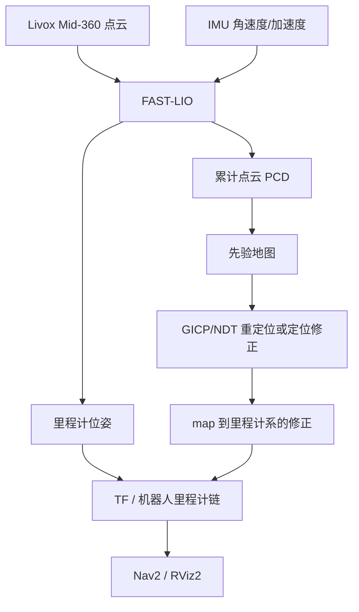
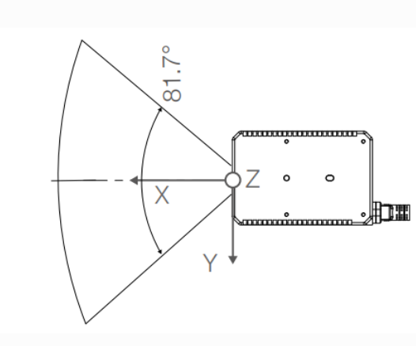
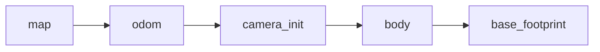
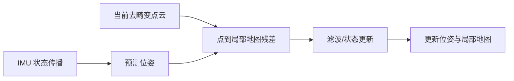
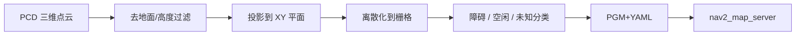

# Livox Mid-360：从原始点云到机器人定位

> **定位主线**：雷达/IMU 采样 → FAST-LIO 里程计 → 地图或定位配准 → TF 坐标变换 → Nav2 消费。本文将原笔记中分散的话题接口、坐标系、PCD 转地图和重定位知识按数据流重排。

## 1. 先明确每个模块的职责

| 模块 | 输入 | 输出 | 不能替代什么 |
| --- | --- | --- | --- |
| `livox_ros_driver2` | 雷达和 IMU 的硬件数据 | 原始点云及惯导话题 | 不负责地图定位 |
| FAST-LIO | 点云、IMU | 里程计位姿、已配准点云 | 不等同于绝对重定位 |
| 点云地图 / PCD | 累计点云 | 离线三维空间信息 | 本身不是 Nav2 二维栅格地图 |
| GICP / NDT 等配准 | 当前点云 + 先验地图 | 相对地图的修正变换 | 不保证每次都匹配成功 |
| TF2 | 坐标变换关系 | 任意已连通坐标系之间的变换 | 不负责估计真实位姿 |
| Nav2 costmap | 地图、传感器、TF | 路径规划代价地图 | 不替代状态估计 |



## 2. Mid-360 点云是什么？

### 2.1 扫描、点云帧与时间戳

点云是空间采样点的集合，每个点通常有 XYZ 坐标，也可能含强度、时间戳、回波或标签。**消息发布频率**、**扫描重复频率**与**每帧覆盖率**不是同一个概念。非重复扫描会使某一区域随累计时间获得更多采样点。



```bash
ros2 topic list -t
ros2 topic info /livox/lidar -v
ros2 topic hz /livox/lidar
ros2 topic hz /livox/imu
```

在常见 `livox_ros_driver2` 自定义消息模式下，`/livox/lidar` 类型为 `livox_ros_driver2/msg/CustomMsg`；`/livox/imu` 通常为 `sensor_msgs/msg/Imu`。**类型和频率以实际启动参数和 topic 查询结果为准**。

### 2.2 CustomMsg 与 PointCloud2

`CustomMsg` 可以携带 Livox 特定点属性及每点时间偏移，便于精确运动补偿；`PointCloud2` 是通用点云接口，适合接到大部分 ROS 生态工具。修改消息模式之前，应确认 FAST-LIO 当前版本的输入订阅类型与配置是否匹配。

## 3. ROS 2 话题与消息含义

| 典型话题 | 常见消息 | 怎么验证 |
| --- | --- | --- |
| `/livox/lidar` | CustomMsg 或 PointCloud2 | `ros2 topic info -v` |
| `/livox/imu` | Imu | `ros2 topic echo --once` |
| `/Odometry` | `nav_msgs/msg/Odometry` | `ros2 topic echo /Odometry --once` |
| `/cloud_registered_body` | `sensor_msgs/msg/PointCloud2` | RViz2 / topic hz |
| `/Laser_map` | `sensor_msgs/msg/PointCloud2` | 依据 FAST-LIO 配置判断是否发布 |
| `/tf`, `/tf_static` | `tf2_msgs/msg/TFMessage` | `tf2_echo`, `view_frames` |

话题名称**大小写敏感**；不同 FAST-LIO 分支、启动方式、命名空间会使话题不同。不要把上表当成所有工程都固定存在的接口。

## 4. 坐标系和右手法则

ROS 遵循通用右手坐标约定：通常机器人前方为 +X、左侧为 +Y、上方为 +Z。绕 Z 轴逆时针旋转是正 yaw（具体依 REP 103 及坐标系定义）。

### 4.1 odom、map、body 分别是什么？

- `odom`：连续、局部平滑的里程计参考系，允许随时间漂移。
- `map`：全局参考系，定位修正可能使 `map → odom` 产生跳变。
- `base_footprint`：机器人地面投影参考系，常用于二维规划。
- `body` / `camera_init`：一些 LIO 实现使用的 IMU/雷达姿态参考系，**不自动等于** `base_link` 或 `odom`。

下面仅是某类桥接方案的示意，不是 ROS 官方唯一拓扑：



**TF 一条边只能由唯一权威来源负责发布**。例如已由重定位节点发布 `map → odom` 时，不应再启动另一节点发布同名变换；否则出现跳变或忽前忽后的坐标。

### 4.2 齐次变换

$$
\begin{bmatrix}\mathbf p_m\\1\end{bmatrix}=
\underbrace{\begin{bmatrix}R&t\\0&1\end{bmatrix}}_{T_{map\leftarrow body}}
\begin{bmatrix}\mathbf p_b\\1\end{bmatrix}
$$

位置不仅取决于平移 $t$，也取决于旋转 $R$。特别是**有高度差的斜坡上，先做三维坐标变换再把 Z 设零，不等同于忽略高度计算二维距离**。要做纯二维误差计算，应先明确要比较的两个点在同一个坐标系，再使用 XY 差。

```bash
ros2 run tf2_ros tf2_echo map base_footprint
ros2 run tf2_ros tf2_echo camera_init body
ros2 run tf2_tools view_frames
```

## 5. 里程计从哪里来？

FAST-LIO 通常使用 IMU 传播估计状态，并通过当前点与局部地图匹配做更新。其输出为基于初始参考系的连续运动估计；**长期漂移、绝对位置和地图定位是不同问题**。



里程计 `nav_msgs/msg/Odometry` 的 `header.frame_id` 定义位姿的参考系，`child_frame_id` 标识运动本体参考系。不能看到字段 `pose.pose.position.x` 就直接说这是 `map.x`。

### 5.1 ROS 2 Python 订阅里程计

以下放入已有 `ament_python` ROS 2 包的可执行模块；注册入口点后运行。

```python
import math
import rclpy
from rclpy.node import Node
from nav_msgs.msg import Odometry

class OdomMonitor(Node):
    def __init__(self):
        super().__init__('odom_monitor')
        self.create_subscription(Odometry, '/Odometry', self.on_odom, 10)

    def on_odom(self, msg):
        p = msg.pose.pose.position
        q = msg.pose.pose.orientation
        yaw = math.atan2(2*(q.w*q.z + q.x*q.y),
                         1 - 2*(q.y*q.y + q.z*q.z))
        self.get_logger().info(
            f'frame={msg.header.frame_id} x={p.x:.3f} '
            f'y={p.y:.3f} z={p.z:.3f} yaw={yaw:.3f}')

def main():
    rclpy.init()
    node = OdomMonitor()
    try:
        rclpy.spin(node)
    finally:
        node.destroy_node()
        rclpy.shutdown()

if __name__ == '__main__':
    main()
```

该 yaw 计算假定四元数已归一化，适合一般旋转；在大俯仰角工况中，二维 yaw 单独作为姿态描述并不完整。

## 6. PCD 地图如何变成二维占据栅格？

PCD 保存的是三维离散点，Nav2 静态地图常是二维占据图（如 PGM + YAML 或 OccupancyGrid）。两者**不是同一种地图表示**。



坐标转换到栅格索引（地图左下为原点的简单约定）：

$$
i=\left\lfloor\frac{x-x_0}{r}\right\rfloor,\qquad
j=\left\lfloor\frac{y-y_0}{r}\right\rfloor
$$

$r$ 为地图分辨率（米/像素）。真实地图生成还要**区分障碍、已观察空闲区域、未知区域**；直接把点落到格子里只能得到障碍候选，不是完整可导航地图。

```python
import numpy as np
# 点数组 N×3，单位米；仅演示高度过滤和离散映射
points = np.array([[1.2, 0.4, 0.5], [1.25, 0.42, 0.6], [2., 1., 0.0]])
resolution = 0.05
obstacles = points[(points[:, 2] > 0.2) & (points[:, 2] < 1.5)]
indices = np.floor(obstacles[:, :2] / resolution).astype(int)
print(np.unique(indices, axis=0))
```

## 7. 为什么需要重定位？

**里程计**利用传感器连续估计运动，但误差可累积；**全局定位/重定位**用事先构建的地图、外部参考或可识别环境特征重新估计在地图中的位置。

| 方法 | 输入 | 适用性 | 局限 |
| --- | --- | --- | --- |
| GICP / ICP | 当前点云 + 先验点云 | 几何结构丰富的场景 | 易受初值、退化、动态障碍影响 |
| NDT | 当前点云 + 分布地图 | 较大规模的点云匹配 | 参数敏感、依赖质量良好的地图 |
| GNSS / 外部定位 | 外部定位观测 | 开放环境 | 遮挡、精度和坐标转换问题 |
| 闭环检测与图优化 | 历史观察 + 匹配约束 | 长期建图漂移修正 | 不等于每帧实时定位 |

重定位失败不能简单沿用“最后一次地图坐标”作为仍然可信的当前位置；应跟踪匹配收敛情况、残差、协方差或其他质量指标。

## 8. FAST-LIO 常见参数和排查

| 维度 | 例子 | 为什么会影响结果 |
| --- | --- | --- |
| 输入话题 | `lid_topic` / `imu_topic` | 消息不匹配就无法正确融合 |
| 时间同步 | `time_sync_en` | 雷达与 IMU 时序偏差影响去畸变 |
| 点云滤波 | `point_filter_num`, voxel filter | 密度影响算力与几何约束 |
| 迭代 | `max_iteration` | 决定状态更新优化开销 |
| 地图大小 | `cube_side_length` | 控制局部地图空间范围 |
| 自身剔除 | 自定义机体/机械臂盒 | 避免自体点干扰匹配 |

以下字段及层级**需要对照自己所用 FAST-LIO 分支的 YAML 配置**，不可直接认定所有版本通用。

```yaml
common:
  lid_topic: /livox/lidar
  imu_topic: /livox/imu
  time_sync_en: false
```

### 8.1 上坡或台阶之后出现 Z 漂移

先检查传感器外参（雷达到 IMU 的旋转/平移）、重力方向、点云与 IMU 时间戳、局部几何退化、地图更新，再查 TF 发布和地图配准；不要先用代码强制将 z=0 来“修复里程计”。

### 8.2 频率低、卡顿与地图缺失

```bash
ros2 topic hz /livox/lidar
ros2 topic hz /livox/imu
ros2 topic hz /Odometry
ros2 node list
ros2 param list /fastlio_mapping  # 如果此节点名确实存在
```

测量时分别区分**传感器发布频率、里程计更新频率、可视化帧率**。只看 RViz2 画面流畅度不能直接判断估计精度。

## 9. 实验：怎样客观评估定位精度

| 场景 | 记录内容 | 推荐指标 |
| --- | --- | --- |
| 水平直线 | 轨迹、参考位置、起终点误差 | ATE / RPE |
| 上坡与下坡 | 高度变化、姿态估计 | Z 漂移、roll/pitch 误差 |
| 台阶 | 垂直和水平变化 | 跟踪中断率、RPE |
| 回到原点 | 回环前后位姿差 | 闭环误差 |
| 重定位 | 初始化与收敛过程 | 成功率、耗时、残差 |

ATE 是**估计轨迹对参考轨迹的绝对误差**；RPE 是**指定时间跨度的相对运动误差**。要声明定位精度，必须记录传感器环境、参考基准和测试方法；“看起来地图对齐”不是 1 cm 精度证据。

## 10. 复盘检查清单

1. `topic list -t`：消息类型和 topic 名对得上吗？
2. `topic hz`：原始雷达、IMU、里程计频率稳定吗？
3. `tf2_echo`：TF 链接完整且单发布源吗？
4. 检查地图与在线点云的坐标约定、分辨率和尺度。
5. 观察配准状态与评分，再将估计结果交给 Nav2 使用。

**参考**：[Livox Mid-360 下载](https://www.livoxtech.com/cn/mid-360/downloads) · [ROS 2 TF2](https://docs.ros.org/en/humble/Concepts/Intermediate/About-Tf2.html)。
