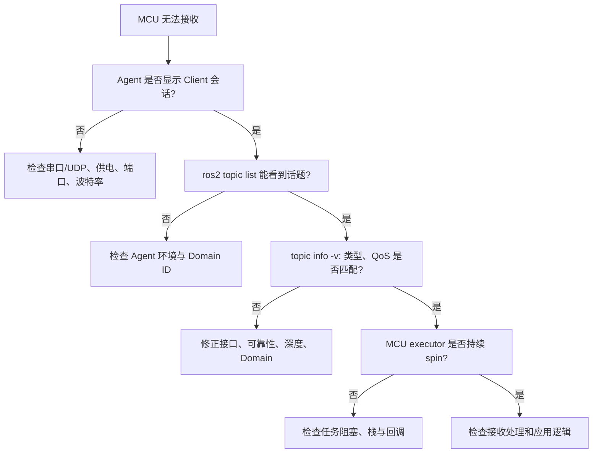

# micro-ROS 通信：ROS 2 与单片机如何连接

> **本文所属知识点**：机器人导航 → 导航支线 → **micro-ROS 通信**。这是嵌入式与 ROS 2 之间的通信技术，涉及单片机上的 micro-ROS Client、Ubuntu 主机上的 micro-ROS Agent、串口/UDP 传输与 ROS 2 DDS 网络。
>
> 本篇以官方 [micro_ros_setup（Humble 分支）](https://github.com/micro-ROS/micro_ros_setup/tree/humble) 为主要依据；原文件中的 ROS 2 C++ 面向对象、lambda 和线程基础内容不属于 micro-ROS 安装与通信主线，应放到 `ROS2基础编程.md` 或 C++ 知识章节。

## 1. micro-ROS 解决什么问题？

常规 ROS 2 主要运行在 Linux 等计算资源较丰富的设备；微控制器（MCU）通常内存小、没有完整 Linux 用户态，不能直接用 `rclcpp` 实现完全相同的通信栈。micro-ROS 将 ROS 2 API 的一部分带到资源受限设备，并通过 Agent 与 ROS 2 图连接。


- **Client**：位于 MCU，创建 publisher、subscriber、timer 等。
- **Agent**：位于运行 ROS 2 的主机，作为嵌入式 XRCE-DDS 客户端到 DDS 网络之间的桥梁。
- **Transport**：Client 与 Agent 之间的实际数据通道（串口、网络等）。
- **消息与话题**：ROS 2 图中仍可用 `ros2 topic list / echo / pub` 验证通信。

## 2. 环境与硬件前提

以 Ubuntu 22.04 + ROS 2 Humble 为例；先保证 ROS 2 Humble 已正确安装，并且安装有 `colcon`、`rosdep`、基础构建依赖。

```bash
source /opt/ros/humble/setup.bash
printenv ROS_DISTRO           # 应输出 humble
ros2 --help
```

**平台选择非常重要**：`micro_ros_setup` 的固件生成脚本依赖 RTOS 与板卡适配；不是任意 STM32/ESP32 型号都能直接使用相同编译刷写命令。先查询官方 Humble 分支的板卡支持列表和对应教程。

## 3. 安装 micro_ros_setup（官方 Humble 流程）

```bash
source /opt/ros/humble/setup.bash
sudo apt update
sudo apt install -y python3-rosdep python3-colcon-common-extensions git

mkdir -p ~/microros_ws/src
cd ~/microros_ws
git clone -b humble https://github.com/micro-ROS/micro_ros_setup.git src/micro_ros_setup
rosdep update
rosdep install --from-paths src --ignore-src -y
colcon build
source install/local_setup.bash
```

**说明**：若 `rosdep init` 已运行过，不要重复初始化；`rosdep update` 同步索引。`source install/local_setup.bash` 只影响当前终端，打开新终端需重新 source 环境。

## 4. 固件创建 → 配置 → 编译 → 烧录

官方工具的阶段是固定的，但 RTOS、板卡和 transport 是**按需选择的参数**。


### 4.1 创建固件工作空间

下面以官方文档列举的 `FreeRTOS + Olimex STM32-E407` 作为命令示范，**不是所有 STM32 的通用模板**：

```bash
cd ~/microros_ws
source /opt/ros/humble/setup.bash
source install/local_setup.bash
ros2 run micro_ros_setup create_firmware_ws.sh freertos olimex-stm32-e407
```

其他板卡先核对官方 Humble 分支的 RTOS、板卡代号，例如 `freertos esp32` 或特定 Nucleo 型号；如果当前板卡不在支持组合中，应研究其专用 component（如 STM32CubeMX/ESP-IDF 组件），而不是强行套用 Olimex 的刷写步骤。

### 4.2 配置通信方式

```bash
ros2 run micro_ros_setup configure_firmware.sh
```

不带参数运行可以查看**当前目标平台**支持的应用/配置。随后按输出选择 app 和传输方式。官方通用选项包括 `--transport`、`--dev`、`--ip`、`--port`，但具体允许值由目标平台决定。

```bash
# 语法示意：用上一步列出的 APP 名和平台支持的选项替换占位内容
ros2 run micro_ros_setup configure_firmware.sh <APP> --transport <serial-or-udp>
```

### 4.3 编译与刷写

```bash
ros2 run micro_ros_setup build_firmware.sh
ros2 run micro_ros_setup flash_firmware.sh
```

刷写前确认目标板已进入正确的下载模式、USB/串口设备正常且工具链匹配；若板卡使用独立 IDE/烧录器，应遵循对应平台说明。

## 5. 安装并运行 micro-ROS Agent

```bash
cd ~/microros_ws
ros2 run micro_ros_setup create_agent_ws.sh
ros2 run micro_ros_setup build_agent.sh
source install/local_setup.bash
```

### 5.1 串口连接示例

```bash
ls -l /dev/serial/by-id/   # 优先按稳定设备标识核对实际串口
ros2 run micro_ros_agent micro_ros_agent serial --dev /dev/ttyUSB0 -b 115200 -v6
```

这里 `/dev/ttyUSB0`、`115200` **仅是示例**：必须与板卡实际端口和波特率匹配，部分 USB CDC 设备是 `/dev/ttyACM0`。

### 5.2 UDP 连接示例

```bash
ros2 run micro_ros_agent micro_ros_agent udp4 --port 8888 -v6
```

这里的 `8888` 同样是示例；MCU 必须配置 Agent 的实际 IP/端口，且网络可达、传输方式一致。

## 6. MCU 发布与订阅 ROS 2 话题

### 6.1 运行最小自检

在 Agent 运行、MCU 固件成功启动且两端连接正常之后，开新终端：

```bash
source /opt/ros/humble/setup.bash
ros2 topic list -t
ros2 node list
ros2 topic echo /example_topic
```

实际 `example_topic` 应替换为固件发布的话题。若 MCU 只订阅控制话题，可从 PC 发送**低风险测试消息**验证；避免直接向正在运行的电机发送未知速度指令。

### 6.2 MCU 侧 C API 的核心结构（概念性伪代码）

```c
// 以下用于展示 rclc 结构，不是可直接编译的完整板级固件
// 1. 设置传输层、allocator、support、node
// 2. 创建 publisher / subscription
// 3. 初始化 executor，注册 callback
// 4. 在循环中调用 rclc_executor_spin_some(...)
// 5. 检查每个初始化/发布调用的返回值
```

micro-ROS 固件需要板级时钟、传输初始化、消息内存管理、executor 和 RTOS 配置。**不能直接将 Linux 上的 rclcpp C++ 节点复制到单片机运行**。

## 7. 真实故障排查：其他 ROS 2 节点一启动，MCU 就无法收到消息

这种现象**不能直接归因于 ROS_DOMAIN_ID**。应按“物理链路 → Agent → ROS 2 图 → QoS/接口 → MCU 执行器”逐层定位。



```bash
printenv ROS_DOMAIN_ID
ros2 node list
ros2 topic info /speed_heading -v  # 请换成实际话题名
ros2 topic hz /speed_heading
```

**容易混淆的四点**：

1. Agent 连接成功 **≠** ROS 2 话题已经在正确的 Domain 出现。
2. topic 名相同 **≠** 消息类型和 QoS 一定兼容。
3. 接收到传输帧 **≠** 订阅回调一定及时执行，MCU 的 executor 可能被阻塞。
4. Domain ID 隔离解决的是 DDS 域的划分，**不会修复串口冲突、Agent 重启、应用逻辑错误**。

## 8. 常用故障表

| 现象 | 常见原因 | 验证方式 |
| --- | --- | --- |
| Agent 无 Client 连接 | 串口设备错误、权限、波特率、UDP 不通 | Agent `-v6` 日志、`ls /dev`、网络抓包 |
| Agent 正常、topic 不见 | 节点未初始化、Domain 不一致 | `ros2 node list`、环境变量 |
| 能看到话题却收不到 | 消息类型/QoS 不兼容 | `ros2 topic info -v` |
| 偶发丢消息 | 网络、缓冲区、executor 处理不及时 | 统计发布/接收速率与错误码 |
| 一启动其他节点就异常 | 资源竞争、单片机任务阻塞、重复 Agent 或共享通信口 | 逐步启动并记录日志 |

## 9. 从学习到实车的验证顺序

1. **先 Host/示例固件**：确认 micro-ROS Client 与 Agent 可以通。
2. **再裸数据话题**：单向发布与订阅；确认 topic、类型、QoS、Domain。
3. **再接控制链**：为消息增加超时保护，长时间未收到控制指令时进入安全状态。
4. **最后实车测试**：低速、空载，记录 Agent/MCU/ROS 2 三端时间戳和丢包情况。

**官方资料**：

- [micro_ros_setup：Humble 分支](https://github.com/micro-ROS/micro_ros_setup/tree/humble)
- [Humble README：构建与 Agent 命令](https://github.com/micro-ROS/micro_ros_setup/blob/humble/README.md)
- [micro-ROS 构建系统概念](https://micro.vulcanexus.org/docs/concepts/build_system/)
