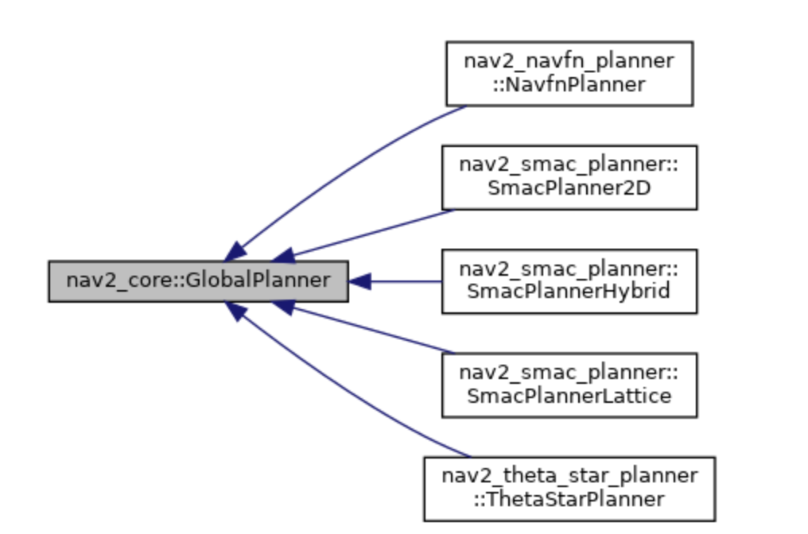

# 机器人导航算法工程

> 本文用于**导航算法学习和项目经验归档**。

### 全局与局部路径规划

**一.Dijkstra与A\*全局路径规划算法**

1.第一部分：建立路径规划的数学模型

- 什么是路径规划？
  - 机器人需要在存在障碍物的环境中找到一条从起点到目标点的可通行路径
  - 最小代价路径不一定是几何距离最短的路径（例如，一条路径长5米，但紧贴障碍物；另一条路径长5.5米，却拥有更大的安全距离。加入障碍物代价以后，第二条路径可能更优）
- 将地图转换为图结构
  - 最基础的二维栅格地图可以采用四邻域或八邻域搜索

2.第二部分：Dijkstra算法推导

- 核心思想
  - 基于累计路径代价的最短路径搜索算法
    - 维护一个数组：`g(v)`
    - `g(v)<=min(g(v),g(u)+c(u,v))`
  - 会按照从起点向外扩展的方式搜索（即使终点明确位于右上方，它仍然可能话费大量时间探索左侧和下方的区域）

3.第三部分：A\*算法的推导

- 评价函数

  - 在Dijkstra的基础上增加了启发函数

$$
f(n)=g(n)+h(n)
$$

| 符号 | 数学意义                  | 对应的工程意义           |
| ---- | ------------------------- | ------------------------ |
| g(n) | 起点到节点n的已知累计代价 | 已经走过的代价           |
| h(n) | 节点n到终点的估计剩余代价 | 估计还需要走多远         |
| f(n) | 两者之和                  | 选择下一个搜索节点的依据 |

- 常见的启发函数

- （1）曼哈顿距离

$$
h(n)=|x_g-x_n|+|y_g-y_n|
$$

- 适用于单位代价的四邻域移动

- （2）欧几里得距离

$$
h(n)=\sqrt{(x_g-x_n)^2+(y_g-y_n)^2}
$$

- 表示两点之间的直线距离

- （3）Octile距离

- 设

$$
\boxed{d_x=|x_g-x_n|}, \boxed{d_y=|y_g-y_n|}
$$

$$
{ h(n)=\max(d_x,d_y)+(\sqrt2-1)\min(d_x,d_y) }
$$

- 适用于八邻域栅格搜索

- 为什么A\*能保证最优性？

  - 设从当前节点到终点的真实最优剩余代价为：h*(n)
  - 如果启发函数满足：

$$
\boxed{h(n)\leq h^*(n)}
$$

- 这个启发函数具有可采纳性（它不能高估真实的剩余代价）
  - 如果启发函数还满足：

$$
\boxed{h(u)\leq c(u,v)+h(v)}
$$

- 这个启发函数满足一致性（机器人每向前移动一步，启发函数估计的剩余代价不能减少得比这一步的实际移动代价还多）
  - A\*并不是因为启发函数能准确预测最短路径才保证最优，而是因为启发函数不会高估，并且搜索不会再仍有更优路径可能存在时提前结束

4.第四部分：研究Nav2的源码

- 规划器接口

```text
nav2_core/include/nav2_core/global_planner.hpp
```

  - 需要重点理解的方法

```cpp
nav_msgs::msg::Path createPlan(
    const geometry_msgs::msg::PoseStamped & start,
    const geometry_msgs::msg::PoseStamped & goal
) override;
```

  - 规划器在 `configure()` 阶段已经可以获得 Costmap 的相关对象，规划时可以从中取得地图数据

  - 

- 研究NavFn

  - 源码：

    [navfn_planner.cpp](https://api.nav2.org/nav2-humble/html/navfn__planner_8cpp_source.html?utm_source=chatgpt.com)

  - 重点查看

```cpp
NavfnPlanner::createPlan()
```

- NavFn 提供 `use_astar` 参数，用于选择 A\* 或默认的 Dijkstra 类搜索实现。

```yaml
GridBased:
  use_astar: false
```

- 研究 SmacPlanner2D

  - 源码：

    [smac_planner_2d.cpp](https://api.nav2.org/nav2-humble/html/smac__planner__2d_8cpp_source.html?utm_source=chatgpt.com)

  - 重点查看

```cpp
SmacPlanner2D::createPlan()
```

- SmacPlanner2D 使用经过工程优化的 A\* 实现，支持栅格搜索，并结合代价地图、碰撞检测等功能。

**二.A\*算法进阶（启发函数优化、障碍物代价与路径平滑）**
