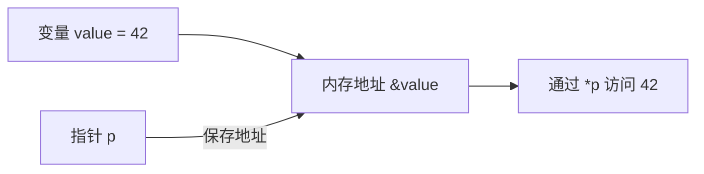
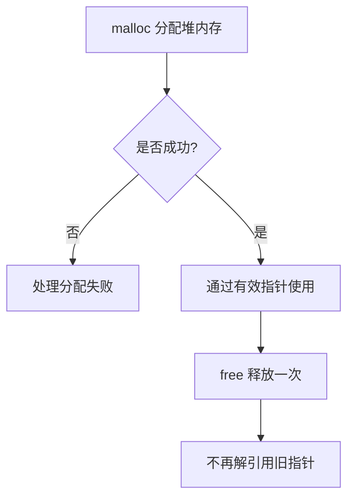

# C 语言：从语法到内存模型

> **学习主线**：编译流程 → 变量和类型 → 表达式/流程控制 → 函数 → 数组和字符串 → 指针 → 结构体 → 动态内存 → 文件 I/O → 编译与调试。将原笔记中分散的运算符、输入输出、地址、数组、存储类型与指针章节按依赖关系组织。

## 1. 为什么还要学 C？

C 是编译型、接近底层机器模型的通用语言，常用于嵌入式驱动、操作系统、接口库和高性能模块。C 程序运行时仍依赖操作系统/运行库/ABI，不能简单说“C 直接控制所有硬件”。


```c
#include <stdio.h>

int main(void) {
    printf("Hello C\n");
    return 0;
}
```

```bash
gcc -std=c11 -Wall -Wextra -Wpedantic main.c -o main
./main
```

`#include` 将头文件声明纳入编译单元；`main` 是程序入口；`return 0` 表示成功。建议开启编译器警告，不要忽略类型不匹配、未初始化等告警。

## 2. 变量、常量与数据类型

| 类型 | 典型用途 | 注意 |
| --- | --- | --- |
| `char` | 字符或最小可寻址字节 | 有符号性依实现而异 |
| `int` | 常规整数 | 宽度依平台，不能假设一定 32 位 |
| `long`, `long long` | 较宽整数 | 具体字节数受 ABI 影响 |
| `float`, `double` | 近似实数 | 存在舍入误差 |
| `_Bool` / `bool` | 真假值 | C99 可 `#include <stdbool.h>` |
| `size_t` | 对象大小、数组长度 | 无符号整数类型 |

```c
#include <stdint.h>
#include <inttypes.h>
#include <stdio.h>

int main(void) {
    int32_t count = 12;
    double distance = 3.5;
    const double scale = 0.1;
    printf("count=%" PRId32 ", value=%.2f\n", count, distance * scale);
    return 0;
}
```

这里 `int32_t` 仅在目标平台存在 32 位有符号整数类型时定义；处理跨平台协议和硬件寄存器时，明确整数宽度非常重要。

## 3. 输入输出与类型转换

```c
#include <stdio.h>

int main(void) {
    int age;
    printf("age: ");
    if (scanf("%d", &age) != 1) {
        fputs("invalid input\n", stderr);
        return 1;
    }
    printf("age = %d\n", age);
    return 0;
}
```

`scanf` 的 `%d` 需要 `int*`，所以传 `&age`。始终检查返回值，否则输入不符合预期时变量可能未正确赋值。读取整行文本常可使用 `fgets` 再解析。

### 3.1 表达式与常见陷阱

- `a / b`：若两者都是整数，执行整数除法。
- `a % b`：整数取余，`b=0` 不合法。
- `i++` 产生自增前的值，`++i` 产生自增后的值；不能在一个表达式中无序多次修改同一标量对象。
- `=` 是赋值，`==` 才是相等比较。
- 浮点数不能假定每个十进制小数都能被二进制精确表示。

## 4. 条件与循环

```c
int classify(int score) {
    if (score >= 90) return 2;
    if (score >= 60) return 1;
    return 0;
}

void countdown(int n) {
    for (int i = n; i > 0; --i) {
        printf("%d\n", i);
    }
}
```

`switch` 适合离散整数/枚举状态，`break` 防止向后继续执行到其他 case。`for`、`while`、`do ... while` 的选择取决于循环次数与是否至少执行一次。

## 5. 函数、声明、头文件与作用域

```text
main.c                math_utils.c
  │                        │
  └────────► math_utils.h ◄┘
                函数声明
```

```c
// math_utils.h
#ifndef MATH_UTILS_H
#define MATH_UTILS_H
int add(int a, int b);
#endif
```

```c
// math_utils.c
#include "math_utils.h"
int add(int a, int b) { return a + b; }
```

函数的**声明**告诉编译器接口，**定义**提供实现。局部变量具有块作用域；文件作用域变量可受 `static` 控制链接可见性。函数一般按值传参；需要修改调用者对象时常传入指针。

## 6. 数组与字符串

```c
#include <stdio.h>
#include <string.h>

int main(void) {
    int values[] = {3, 1, 4};
    size_t count = sizeof(values) / sizeof(values[0]);
    char name[] = "robot";      // 末尾自动包含 '\0'
    printf("%zu, %zu\n", count, strlen(name));
    return 0;
}
```

C 字符串由字符数组和终止字节 `\0` 组成；`strlen` 不包含终止字节。**数组传给函数时通常退化为指向首元素的指针**，因此函数内 `sizeof(ptr)` 不能用来计算原数组元素个数。

### 6.1 字符串缓冲区边界

```c
char buf[16];
snprintf(buf, sizeof buf, "x=%d", 123);
```

尽量避免无边界的 `strcpy`、`sprintf`；要明确输出缓冲区大小并检查截断。

## 7. 指针：理解地址、解引用与生命周期



```c
int value = 42;
int *p = &value;
*p = 43;             // 修改 value
```

- `&value` 取得地址；`*p` 解引用该地址对应的对象。
- `NULL` 表示空指针；解引用空指针、悬空指针或越界指针都是严重错误。
- `p + 1` 是按所指对象大小移动一个元素，不是简单加一个字节。
- 指针类型决定解引用的对象类型与对齐要求。

### 7.1 交换变量为什么需要指针？

```c
void swap(int *a, int *b) {
    if (a == NULL || b == NULL) return;
    int temp = *a;
    *a = *b;
    *b = temp;
}
```

当希望函数修改调用者变量时，将变量地址传进去。这不是 C 的“引用传参”；本质仍然是**按值传递指针**。

## 8. 二维数组与指针数组

```c
int matrix[2][3] = {{1, 2, 3}, {4, 5, 6}};
int (*row_ptr)[3] = matrix;  // 指向具有3个int元素的数组
int *values[2] = {matrix[0], matrix[1]}; // 两个int指针组成的数组
```

`int (*p)[3]` 和 `int *p[3]` 含义完全不同。多维数组在内存中行优先连续排列，不能无条件用 `int**` 接收二维数组。

## 9. 结构体、枚举、联合体与位运算

```c
#include <stdint.h>

typedef enum {
    DEVICE_OFF = 0,
    DEVICE_ON = 1
} DeviceState;

typedef struct {
    uint32_t id;
    float voltage;
    DeviceState state;
} Device;
```

结构体各字段可能因对齐存在填充字节；不能默认 `sizeof(struct)` 等于字段字节大小之和。传输网络协议或写磁盘时应显式定义序列化格式，不要直接发送整个内存结构。

位运算适合操作寄存器掩码：

```c
uint32_t flags = 0;
flags |= (1u << 3);   // 置位 bit3
flags &= ~(1u << 3);  // 清除 bit3
```

涉及移位宽度、负数与有符号溢出时，要检查 C 标准限制，优先使用无符号整型进行位掩码计算。

## 10. 动态内存管理



```c
#include <stdlib.h>
#include <stdio.h>

int main(void) {
    const size_t n = 100;
    int *data = malloc(n * sizeof *data);
    if (data == NULL) return 1;
    for (size_t i = 0; i < n; ++i) data[i] = (int)i;
    printf("%d\n", data[10]);
    free(data);
    data = NULL;
    return 0;
}
```

重点区分：**栈上的自动存储期对象**随作用域结束失效，`malloc` 返回的动态分配内存必须显式 `free`；并不是所有“局部变量”都无条件在机器栈上实现。

### 10.1 常见错误

- 使用未初始化指针；
- 访问已释放的内存（use-after-free）；
- 重复 `free`；
- 越界写入；
- 丢失唯一指针导致内存泄漏；
- `realloc` 失败时覆盖旧指针而丢失原内存。

## 11. 文件 I/O 与错误处理

```c
#include <stdio.h>

int main(void) {
    FILE *fp = fopen("output.txt", "w");
    if (fp == NULL) {
        perror("fopen");
        return 1;
    }
    if (fprintf(fp, "hello\n") < 0) {
        perror("fprintf");
        fclose(fp);
        return 1;
    }
    if (fclose(fp) != 0) {
        perror("fclose");
        return 1;
    }
    return 0;
}
```

`fopen`、`fread`、`fwrite`、`fclose` 都可能失败。文本和二进制数据在格式与平台行为上有区别，跨平台文件应明确编码、字节序和版本。

## 12. 编译期检查与调试

```bash
gcc -std=c11 -Wall -Wextra -Wpedantic -g -O0 main.c -o main
# Linux / GCC / Clang 上可额外使用 sanitizer
gcc -std=c11 -g -fsanitize=address,undefined main.c -o main_asan
```

编译器警告、调试器断点、单元测试和动态内存检测应该组合使用；编译通过只意味着语法/链接满足要求，不代表程序无未定义行为。

## 13. 练习路线

1. 写读取多个数值、计算最大值与平均值的程序，检查所有输入。
2. 手写字符串长度函数，保证不会越界访问。
3. 使用结构体和动态数组保存多条传感器记录。
4. 将功能拆成 `main.c`、`records.c`、`records.h` 并独立编译链接。
5. 故意制造一次越界访问，观察 AddressSanitizer 输出并修复。
