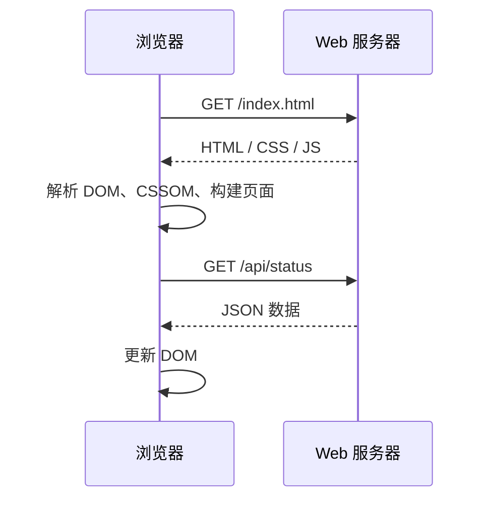
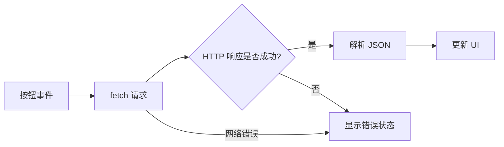

# Web 前端基础：页面如何与后端协同

> 原笔记以 HTML/CSS/JS 的 Day 课程顺序组织，部分布局和异步内容混杂。这里改按 **页面语义 → 样式布局 → DOM 交互 → 网络请求 → 实际工程** 学习。

## 1. 浏览器、服务器和页面分别做什么？



HTML 负责**结构与语义**；CSS 负责**外观与布局**；JavaScript 负责**行为与数据交互**。DOM 是浏览器解析 HTML 后形成的文档对象树。

## 2. HTML：先写语义，再考虑外观

```html
<!doctype html>
<html lang="zh-CN">
<head>
  <meta charset="utf-8">
  <meta name="viewport" content="width=device-width, initial-scale=1">
  <title>设备监控</title>
  <link rel="stylesheet" href="style.css">
</head>
<body>
  <main class="dashboard">
    <h1>设备监控</h1>
    <section aria-labelledby="status-title">
      <h2 id="status-title">在线状态</h2>
      <p id="device-status">加载中…</p>
      <button id="refresh" type="button">刷新</button>
    </section>
  </main>
  <script src="app.js" defer></script>
</body>
</html>
```

- `header`、`nav`、`main`、`section`、`article` 是语义标签，不要只用一大堆 `div` 替代结构。
- 表单使用 `label` 关联输入框，按钮使用原生 `button`，改善键盘与辅助技术可访问性。
- 链接 `<a>` 用于导航，按钮用于执行操作；不能仅靠视觉外观决定标签。

## 3. CSS：盒模型、选择器与布局

### 3.1 盒模型

```text
┌──────────── Margin ─────────────┐
│ ┌────────── Border ──────────┐ │
│ │ ┌──────── Padding ───────┐ │ │
│ │ │       Content          │ │ │
│ │ └────────────────────────┘ │ │
│ └────────────────────────────┘ │
└────────────────────────────────┘
```

```css
* { box-sizing: border-box; }
body { margin: 0; font-family: system-ui, sans-serif; }
.dashboard { max-width: 960px; padding: 24px; margin-inline: auto; }
section { padding: 20px; border: 1px solid #ddd; border-radius: 12px; }
```

在 `border-box` 下，声明的 `width` 包含 padding 与 border，通常更方便构建响应式布局。

### 3.2 Flex 与 Grid 的区别

| 方案 | 更适合 | 核心属性 |
| --- | --- | --- |
| Flex | 单行/单列对齐 | `display:flex`, `gap`, `justify-content` |
| Grid | 行列二维排布 | `display:grid`, `grid-template-columns` |
| Position | 特殊定位和覆盖 | `relative`, `absolute`, `fixed`, `sticky` |

```css
.card-list {
  display: grid;
  grid-template-columns: repeat(auto-fit, minmax(220px, 1fr));
  gap: 16px;
}
.toolbar { display: flex; align-items: center; gap: 12px; }
@media (max-width: 640px) { .dashboard { padding: 12px; } }
```

**选择器优先级**要与 CSS 的来源、层叠顺序一起分析；不要通过不断追加 `!important` 解决所有样式问题。

## 4. JavaScript：基础数据与函数

```javascript
const state = { connected: false, fps: 0 };
function formatFps(fps) {
  return `${fps.toFixed(1)} FPS`;
}
const summary = [12, 18, 15].map(formatFps);
console.log(summary);
```

`const` 表示绑定不能重新赋值，不代表对象内部属性不可修改。`let` 用于需要重新赋值的变量，优先避免 `var`。

### 4.1 对象、数组和常见方法

- 数组 `map` 生成新映射数组，`filter` 选择元素，`find` 找到第一个匹配值。
- 对象用于表达键值结构，`JSON.stringify`/`JSON.parse` 用于序列化和解析 JSON。
- `===` 会比较值及类型，通常比会发生隐式转换的 `==` 更安全。

## 5. DOM：怎样让页面响应交互？

```javascript
const label = document.querySelector('#device-status');
const button = document.querySelector('#refresh');
button.addEventListener('click', () => {
  label.textContent = '正在刷新…';
});
```

展示用户输入时优先使用 `textContent` 而不是直接赋值 `innerHTML`，防止不可信文本被解释成 HTML。

## 6. Promise、async/await 与 Fetch



```javascript
async function refreshStatus() {
  const label = document.querySelector('#device-status');
  try {
    const response = await fetch('/api/status', { cache: 'no-store' });
    if (!response.ok) throw new Error(`HTTP ${response.status}`);
    const data = await response.json();
    label.textContent = data.online ? '在线' : '离线';
  } catch (error) {
    console.error(error);
    label.textContent = '请求失败，请稍后重试';
  }
}
document.querySelector('#refresh').addEventListener('click', refreshStatus);
refreshStatus();
```

**Fetch 遇到 404 或 500 不一定拒绝 Promise**，需要检查 `response.ok`；网络异常才直接触发拒绝。

## 7. HTTP、JSON、状态码和跨域

| 状态码 | 常见含义 |
| --- | --- |
| 200 | 请求成功 |
| 201 | 创建资源成功 |
| 400 | 请求参数有问题 |
| 401 | 未通过身份验证 |
| 403 | 已识别身份但无权限 |
| 404 | 资源不存在 |
| 500 | 服务器内部出错 |

CORS 是浏览器执行的跨域访问控制机制，不是服务器之间访问的通用防火墙。部署时应使用 HTTPS，合理管理认证 Cookie/Token，并检查跨域、CSRF 与 XSS 风险。

## 8. 前后端联调示例：Flask 最小 API

```python
from flask import Flask, jsonify
app = Flask(__name__)

@app.get('/api/status')
def status():
    return jsonify(online=True, fps=18.5)

if __name__ == '__main__':
    app.run(debug=True)  # 仅用于本机开发，勿暴露公网
```

如使用 Flask 提供前端静态文件，应明确静态文件目录和资源 URL，或由反向代理与 Flask 分开部署。

## 9. 调试路线与可维护性

1. 浏览器 Elements：DOM 结构是否符合预期？
2. Computed Styles：哪个 CSS 规则覆盖了布局？
3. Console：是否存在 JS 语法异常或异步错误？
4. Network：请求 URL、方法、响应码、JSON 内容正确吗？
5. Server 日志：后端是否收到请求，数据库或权限是否失败？

**实践**：实现三个设备卡片、刷新按钮、加载提示和错误状态；再用 Grid 排版兼容手机。掌握之后再进入 Vue/React，而不是一开始就把框架与 HTML、DOM 基础混为一谈。
