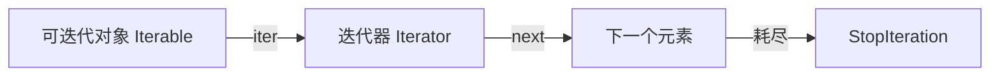

# Python 核心语法：从第一行代码到完整脚本

> 原笔记以 Day 4、Day 5 等课程顺序记录。这里统一改为按知识依赖排序：运行环境 → 类型 → 流程 → 容器 → 函数 → 迭代与装饰器 → 文件 → 项目组织。

## 1. 程序的执行与环境

Python 源文件通常由解释器执行。版本、解释器路径和第三方包环境要分开看。

```bash
python --version
python -m venv .venv
# Windows PowerShell: .\.venv\Scripts\Activate.ps1
# Linux: source .venv/bin/activate
python -m pip install --upgrade pip
python main.py
```

```python
# main.py
name = "Python"
print(f"Hello, {name}!")
```

### 1.1 编码与字符串

源代码一般采用 UTF-8。Python 3 的 `str` 表示 Unicode 文本；`bytes` 是二进制字节，网络、文件接口常需要显式编码/解码。

```python
text = "机器人导航"
data = text.encode("utf-8")
print(data, data.decode("utf-8"))
```

## 2. 类型、变量与对象引用

| 类型 | 示例 | 可变性 |
| --- | --- | --- |
| `int`, `float`, `bool` | `3`, `1.5`, `True` | 不可变 |
| `str`, `tuple` | `'abc'`, `(1, 2)` | 不可变 |
| `list`, `dict`, `set` | `[1]`, `{'a':1}`, `{1}` | 可变 |
| `NoneType` | `None` | 单例空值 |

```python
a = [1, 2]
b = a            # 指向同一个列表
b.append(3)
print(a)         # [1, 2, 3]
c = a.copy()     # 浅复制
```

`=` 通常是**把名称绑定到对象**，不是复制对象。`==` 比较值，`is` 比较对象身份；判断 `None` 应用 `is None`。

## 3. 运算、分支与循环

```python
speed = 0.45
if speed < 0:
    state = "reverse"
elif speed == 0:
    state = "stop"
else:
    state = "forward"

for i in range(3):
    print(i)
```

`/` 是真除法，`//` 是向下取整除法；浮点数不适合直接拿 `==` 判断近似测量值相等。

```python
import math
print(math.isclose(0.1 + 0.2, 0.3, rel_tol=1e-9, abs_tol=1e-12))
```

循环中的 `break` 跳出当前循环，`continue` 跳过本轮剩余语句；`for ... else` 的 `else` 在循环没有被 `break` 提前终止时执行。

## 4. 四大容器：何时用哪个？

| 容器 | 有序？ | 允许重复？ | 常用操作 |
| --- | --- | --- | --- |
| `list` | 有序 | 允许 | 追加、切片、排序 |
| `tuple` | 有序 | 允许 | 固定结构记录 |
| `set` | 无索引顺序语义 | 不允许 | 去重、集合运算 |
| `dict` | 保留插入顺序 | 键唯一 | 键值查询、统计 |

```python
records = ["pothole", "crack", "pothole"]
counts = {}
for label in records:
    counts[label] = counts.get(label, 0) + 1
print(counts)
print(sorted(set(records)))
```

`dict` 键必须可哈希；列表不能直接作为字典键。`sorted(...)` 生成新列表，`list.sort()` 就地修改原列表并返回 `None`。

## 5. 字符串处理与格式化

```python
record = "  crack,0.87  "
label, confidence = record.strip().split(",")
print(f"类型={label}，置信度={float(confidence):.2%}")
```

f-string 适合组合变量与格式，`:.2f` 表示两位小数，`:.2%` 表示百分比。面对不可信输入，应捕获数字转换异常。

## 6. 函数、参数与作用域

```python
def clamp(value: float, minimum: float, maximum: float) -> float:
    if minimum > maximum:
        raise ValueError("minimum must <= maximum")
    return max(minimum, min(maximum, value))

print(clamp(1.5, 0.0, 1.0))
```

**形参与实参**：函数定义写形参，调用时传实参。位置参数、关键字参数和默认参数分别解决不同调用需求；函数内部名称默认是局部作用域。

### 6.1 不要使用可变对象作为默认值

```python
# 推荐：新列表由函数每次调用创建
def append_result(value, results=None):
    if results is None:
        results = []
    results.append(value)
    return results
```

默认值在定义函数时计算一次，`def f(data=[])` 容易让多次调用共享同一列表。

## 7. 迭代器、生成器与装饰器



```python
def read_valid_numbers(lines):
    for line in lines:
        line = line.strip()
        if line:
            yield float(line)

print(list(read_valid_numbers(["1.2", "", "3.4"])))
```

生成器通过 `yield` 惰性地产生结果，不必把所有数据同时加载到内存。

```python
from functools import wraps

def trace(fn):
    @wraps(fn)
    def wrapper(*args, **kwargs):
        print(f"call: {fn.__name__}")
        return fn(*args, **kwargs)
    return wrapper

@trace
def add(a, b):
    return a + b
```

装饰器用于在不改变原始函数主体的前提下包装额外行为，例如日志、性能统计、权限检查。闭包是内部函数引用外层函数变量的机制。

## 8. 异常、文件与上下文管理

```python
from pathlib import Path

path = Path("results.csv")
try:
    content = path.read_text(encoding="utf-8")
except FileNotFoundError:
    content = "label,score\n"
print(content)
```

```python
with open("results.csv", "a", encoding="utf-8", newline="") as f:
    f.write("crack,0.82\n")
```

`with` 会在离开作用域时管理资源关闭，异常发生时仍能清理。捕获异常应尽量只捕获预期类型，不用空的 `except:` 吞掉所有错误。

## 9. 模块、包和项目组织

```text
project/
├── main.py
├── pyproject.toml
├── app/
│   ├── __init__.py
│   ├── parser.py
│   └── models.py
└── tests/
    └── test_parser.py
```

- **模块**：一个 `.py` 文件；**包**：按规范组织的一组模块。
- `if __name__ == '__main__':` 防止导入模块时意外执行脚本入口代码。
- MVC（Model-View-Controller）是架构分层思想，与 Python 模块机制不是同一概念。

## 10. 综合案例：清洗检测记录

```python
import csv
from pathlib import Path

def summarize(src: Path, dst: Path) -> None:
    counts = {}
    with src.open(newline="", encoding="utf-8") as f:
        for row in csv.DictReader(f):
            label = (row.get("label") or "").strip().lower()
            if label:
                counts[label] = counts.get(label, 0) + 1
    with dst.open("w", newline="", encoding="utf-8") as f:
        writer = csv.writer(f)
        writer.writerow(["label", "count"])
        writer.writerows(sorted(counts.items()))

if __name__ == "__main__":
    summarize(Path("input.csv"), Path("summary.csv"))
```

## 11. 自测清单

1. 能解释列表赋值和复制之间的区别。
2. 会写含参数验证、返回类型、异常处理的函数。
3. 会用生成器处理数据流，用 `with` 管理文件。
4. 会把脚本拆成模块，并用 `python -m` 或正确的项目入口运行。
