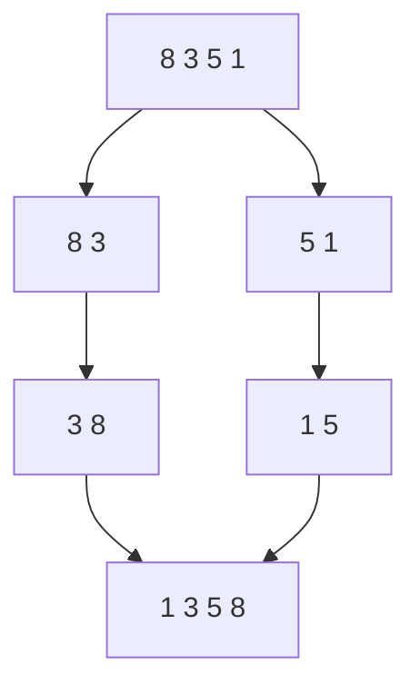
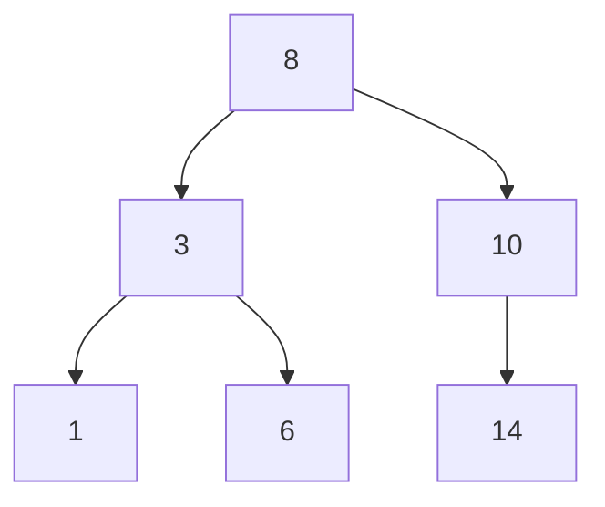

# 数据结构与算法：从复杂度到路径规划

> 原笔记包含 60 余个课程章节，排序、树结构、练习题与图论交叉重复。新版按 **复杂度 → 线性表 → 查找排序 → 树与堆 → 哈希 → 图与最短路 → 贪心与动态规划** 组织；每节强调何时使用、时间复杂度和可运行代码。

## 1. 算法到底要解决什么？

算法是将输入转化为输出的一系列明确步骤。性能不能只看一次运行耗时，应分析输入规模 $n$ 增大时的资源增长趋势。

### 1.1 时间复杂度与空间复杂度

| 量级 | 常见场景 | 特点 |
| --- | --- | --- |
| $O(1)$ | 数组已知下标访问 | 与 n 无关的常数量级 |
| $O(\log n)$ | 二分查找 | 每轮缩小固定比例 |
| $O(n)$ | 遍历列表 | 所有元素都看一遍 |
| $O(n\log n)$ | 高效比较排序 | 排序常见目标量级 |
| $O(n^2)$ | 两层完整嵌套遍历 | n 倍增成本约四倍 |
| $O(2^n)$ | 穷举所有子集 | 很快不可承受 |

```python
# O(n)：对 n 个元素逐一检查
def count_positive(values):
    total = 0
    for value in values:
        if value > 0:
            total += 1
    return total
```

空间复杂度考察额外内存，如新建长度 n 的数组一般是 $O(n)$；递归深度也消耗调用栈空间。

## 2. 递归、分治与迭代

递归必须有**终止条件**，还要确保每次调用都朝终止条件接近。

```python
def factorial(n):
    if n < 0:
        raise ValueError('n must be nonnegative')
    if n <= 1:
        return 1
    return n * factorial(n - 1)
```

分治通常分为分解、递归求解、合并。汉诺塔满足 $T(n)=2T(n-1)+1$，需要 $2^n-1$ 次移动；这个复杂度来自问题约束而非仅仅因为用了递归。

## 3. 线性结构：数组、链表、栈与队列

| 数据结构 | 基本操作 | 典型用途 |
| --- | --- | --- |
| 动态数组（Python list） | 末尾追加均摊 $O(1)$，中间插入 $O(n)$ | 顺序数据、动态容器 |
| 单/双链表 | 已知节点附近插删 $O(1)$ | 频繁局部链接修改 |
| 栈 LIFO | push/pop | 递归模拟、括号匹配、DFS |
| 队列 FIFO | enqueue/dequeue | BFS、生产者消费者 |
| 双端队列 deque | 两端入队/出队均摊 $O(1)$ | 滑动窗口、任务调度 |


```python
from collections import deque
q = deque([1, 2, 3])
q.append(4)        # 队尾插入
print(q.popleft()) # 队头出队：1

stack = []
stack.append('A')
print(stack.pop()) # LIFO
```

用 Python 列表 `pop(0)` 模拟队列通常是 $O(n)$，BFS 应使用 `collections.deque`。

## 4. 查找：顺序与二分

顺序查找不要求有序，时间 $O(n)$；二分查找要求比较意义上的**有序性**，时间 $O(\log n)$。

```python
def lower_bound(nums, target):
    left, right = 0, len(nums)
    while left < right:
        mid = (left + right) // 2
        if nums[mid] < target:
            left = mid + 1
        else:
            right = mid
    return left  # 第一个 >= target 的位置

assert lower_bound([1, 2, 2, 4], 2) == 1
```

循环不变量：答案始终在半开区间 `[left, right)`，这样对空数组、重复元素和不存在的目标都能给出一致的插入位置。

## 5. 排序：为什么要学这么多种？

排序不是背代码，而是分析**比较次数、数据移动、额外空间、稳定性和适用范围**。

| 算法 | 平均时间 | 最坏时间 | 空间 | 稳定? |
| --- | --- | --- | --- | --- |
| 冒泡 | $O(n^2)$ | $O(n^2)$ | $O(1)$ | 是（常见实现） |
| 选择 | $O(n^2)$ | $O(n^2)$ | $O(1)$ | 通常否 |
| 插入 | $O(n^2)$ | $O(n^2)$ | $O(1)$ | 是 |
| 快排 | $O(n\log n)$ | $O(n^2)$ | 依实现 | 通常否 |
| 归并 | $O(n\log n)$ | $O(n\log n)$ | $O(n)$ | 是 |
| 堆排 | $O(n\log n)$ | $O(n\log n)$ | $O(1)$ | 否 |

### 5.1 插入排序（适合小规模或近乎有序的数据）

```python
def insertion_sort(a):
    a = a.copy()
    for i in range(1, len(a)):
        value, j = a[i], i - 1
        while j >= 0 and a[j] > value:
            a[j + 1] = a[j]
            j -= 1
        a[j + 1] = value
    return a

assert insertion_sort([4, 1, 3, 2]) == [1, 2, 3, 4]
```

### 5.2 归并排序：分治思想



归并算法的递推关系 $T(n)=2T(n/2)+O(n)$，由主定理得到 $O(n\log n)$。Python 正式工程排序通常直接用内置 `sorted()` 或 `list.sort()`，手写用于理解算法机制。

### 5.3 非比较排序

计数排序对小整数取值范围有效，复杂度通常为 $O(n+k)$（$k$ 为取值范围）；桶排序依赖分布假设；基数排序按位/按字符进行稳定分配。它们不是对任意对象都能无条件替代比较排序。

## 6. 哈希表与字典

哈希表根据哈希值决定存储或查找位置，平均插入/查找约 $O(1)$，冲突严重时可能退化。

```python
def two_sum(nums, target):
    seen = {}
    for i, x in enumerate(nums):
        if target - x in seen:
            return seen[target - x], i
        seen[x] = i
    return None

assert two_sum([2, 7, 11, 15], 9) == (0, 1)
```

哈希表碰撞处理包括拉链法、开放定址法。**哈希表的 hash 与密码学哈希（MD5、SHA-256）用途不同**，MD5 不应作为现代密码安全设计的核心。

## 7. 树、二叉搜索树和 AVL

### 7.1 术语

根、父节点、叶子、深度、高度是树的基本概念；完全二叉树适合数组存储；二叉搜索树（BST）满足左侧小于、右侧大于（重复元素策略由实现规定）。



BST 查询平均 $O(\log n)$，但插入有序数据可能退化为链，最坏 $O(n)$。AVL 树通过 LL、RR、LR、RL 旋转维持高度平衡。

### 7.2 遍历顺序

- 前序：根 → 左 → 右。
- 中序：左 → 根 → 右（BST 中序可得到排序序列）。
- 后序：左 → 右 → 根。
- 层序：借助队列逐层遍历。

## 8. 堆与 Top-K

二叉堆是满足父子之间大小关系的完全二叉树，不等于整个数组严格有序。

```python
import heapq
nums = [8, 2, 6, 1, 9]
print(heapq.nsmallest(3, nums))  # [1, 2, 6]
```

堆排序通过建堆和反复取堆顶实现 $O(n\log n)$ 排序。对于只关心前 k 小/大的问题，大小为 k 的堆可以避免全量排序。

## 9. 图论：从 BFS 到机器人导航

图 $G=(V,E)$ 由顶点和边组成，边可以有权重；栅格地图可视为图，空闲单元是顶点，邻接移动是边。

### 9.1 四邻域、八邻域与边权

```text
四邻域        八邻域
  ↑          ↖ ↑ ↗
← X →        ← X →
  ↓          ↙ ↓ ↘
```

- 四邻域等代价边：曼哈顿距离是常用可采纳启发式。
- 八邻域（正交成本 1、斜向成本 $\sqrt2$）：Octile 距离常适合。
- 实际机器人路径代价可加入**障碍物膨胀代价、转弯代价、安全距离**等。

### 9.2 BFS：无权图最少步数

```python
from collections import deque

def bfs(grid, start, goal):
    rows, cols = len(grid), len(grid[0])
    q = deque([start])
    parent = {start: None}
    for_dirs = [(1, 0), (-1, 0), (0, 1), (0, -1)]
    while q:
        r, c = q.popleft()
        if (r, c) == goal:
            path, cur = [], goal
            while cur is not None:
                path.append(cur)
                cur = parent[cur]
            return path[::-1]
        for dr, dc in for_dirs:
            nxt = (r + dr, c + dc)
            if (0 <= nxt[0] < rows and 0 <= nxt[1] < cols
                    and grid[nxt[0]][nxt[1]] == 0 and nxt not in parent):
                parent[nxt] = (r, c)
                q.append(nxt)
    return None
```

该示例假设 `grid` 非空、所有移动代价均为 1，`start` 可通行。DFS 用栈或递归可找到路径，但**不保证得到最少边数路径**。

### 9.3 Dijkstra 与 A*

Dijkstra 按当前最小已知代价 `g` 扩展；A* 按 `f = g + h` 扩展，以启发函数更有方向性地寻找目标。

$$
f(n)=g(n)+h(n)
$$

对于八邻域、直移代价 $1$、斜移代价 $\sqrt2$ 的网格，Octile 启发函数：

$$
h(n)=\max(d_x,d_y)+(\sqrt2-1)\min(d_x,d_y)
$$

**可采纳性**：$h(n)\le h^*(n)$，不高估真实最短剩余代价。

**一致性**：$h(u)\le c(u,v)+h(v)$，满足单步三角不等式；使用一致性启发式时，标准 A* 图搜索第一次从优先队列弹出节点即确定其最小 g 代价（在非负边权等条件下）。

### 9.4 可运行的通用 A*（四邻域）

```python
import heapq

def astar(grid, start, goal):
    rows, cols = len(grid), len(grid[0])
    def h(node):
        return abs(node[0] - goal[0]) + abs(node[1] - goal[1])
    frontier = [(h(start), 0, start)]
    best_g, parent = {start: 0}, {start: None}
    moves = ((1, 0), (-1, 0), (0, 1), (0, -1))
    while frontier:
        _, g, u = heapq.heappop(frontier)
        if g != best_g[u]:
            continue  # 跳过堆中落后的旧记录
        if u == goal:
            path = []
            while u is not None:
                path.append(u)
                u = parent[u]
            return path[::-1]
        for dr, dc in moves:
            v = (u[0] + dr, u[1] + dc)
            if not (0 <= v[0] < rows and 0 <= v[1] < cols):
                continue
            if grid[v[0]][v[1]] != 0:
                continue
            new_g = g + 1
            if new_g < best_g.get(v, float('inf')):
                best_g[v], parent[v] = new_g, u
                heapq.heappush(frontier, (new_g + h(v), new_g, v))
    return None

grid = [[0]*5 for _ in range(5)]
grid[2][1:4] = [1, 1, 1]
print(astar(grid, (0, 0), (4, 4)))
```

此算法依赖网格有效、起点终点可通行、四邻域代价相同。若将启发函数固定为零，A* 退化为 Dijkstra 的优先级规则。

## 10. 安全距离如何进入最短路径代价？

“距离最短”并不等于“驾驶最安全”。可以定义边代价：

$$
c(u,v)=c_{distance}(u,v)+\lambda c_{obstacle}(v)
$$

第二项根据障碍物接近程度赋予惩罚，$\lambda$ 控制远离障碍的偏好。注意必须让代价**非负且语义明确**，选择启发函数时也不能未经证明地高估真实代价。路径平滑可以改善折线，但必须再次做碰撞检测。

## 11. 贪心与动态规划

**贪心**每一步做局部看起来最好的选择，需要证明贪心选择性质；**动态规划**依赖重叠子问题和最优子结构，以状态转移复用子结果。

### 11.1 活动选择（贪心）

按活动结束时间升序，能选则选，适合经典不相交区间最大数量问题。

```python
def select_activities(intervals):
    selected, end = [], float('-inf')
    for start, finish in sorted(intervals, key=lambda item: item[1]):
        if start >= end:
            selected.append((start, finish))
            end = finish
    return selected
```

注意：**分数背包**可以按价值密度贪心，**0-1 背包**通常不能仅靠同样贪心策略保证最优。

### 11.2 最长公共子序列（LCS）

设 `dp[i][j]` 是 `a[:i]` 与 `b[:j]` 的最长公共子序列长度：

$$
dp[i][j]=\begin{cases}
dp[i-1][j-1]+1 & a_{i-1}=b_{j-1}\\
\max(dp[i-1][j],dp[i][j-1]) & \text{otherwise}
\end{cases}
$$

```python
def lcs_len(a, b):
    dp = [[0]*(len(b)+1) for _ in range(len(a)+1)]
    for i in range(1, len(a)+1):
        for j in range(1, len(b)+1):
            if a[i-1] == b[j-1]:
                dp[i][j] = dp[i-1][j-1] + 1
            else:
                dp[i][j] = max(dp[i-1][j], dp[i][j-1])
    return dp[-1][-1]

assert lcs_len('ABCBDAB', 'BDCABA') == 4
```

常见动态规划例题还有钢条切割、背包、斐波那契、路径计数。先写出 `状态、选择、边界、转移`，再动手实现。

## 12. 其他重要基础算法

- **欧几里得算法**：$\gcd(a,b)=\gcd(b,a\bmod b)$。
- **并查集**：维护集合连通关系，路径压缩 + 按秩合并使操作具有很好的均摊性能。
- **二叉搜索与 AVL**：维护有序集合，适用于平衡树场景。
- **B 树 / B+ 树**：多路平衡结构，常用于数据库与外存索引。

## 13. 怎样对算法做性能测试？

```python
from time import perf_counter

def benchmark(fn, *args):
    t0 = perf_counter()
    value = fn(*args)
    return value, perf_counter() - t0
```

实际测试应对多种输入规模和分布重复测量、取统计量，不要用某一次微秒级时间来证明渐近复杂度；并区分 Python 实现开销与算法理论性能。

## 14. 学习任务（按深度推进）

1. 手写：二分查找、插入排序、归并排序、BFS、Dijkstra、A*。
2. 数学推导：时间复杂度、八邻域 Octile、A* 可采纳性与一致性。
3. 阅读 Nav2：区分 NavFn（可配置 Dijkstra / A*）与 SmacPlanner2D 的算法实现。
4. 工程实验：构建同一张地图，对比路径长度、最小障碍间距、耗时、扩展节点数量。
5. 进阶：与代价地图和碰撞检测结合，评估路径平滑带来的收益与碰撞风险。
