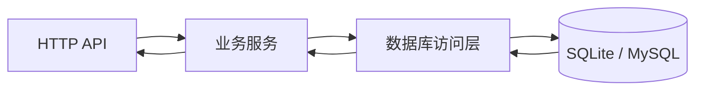
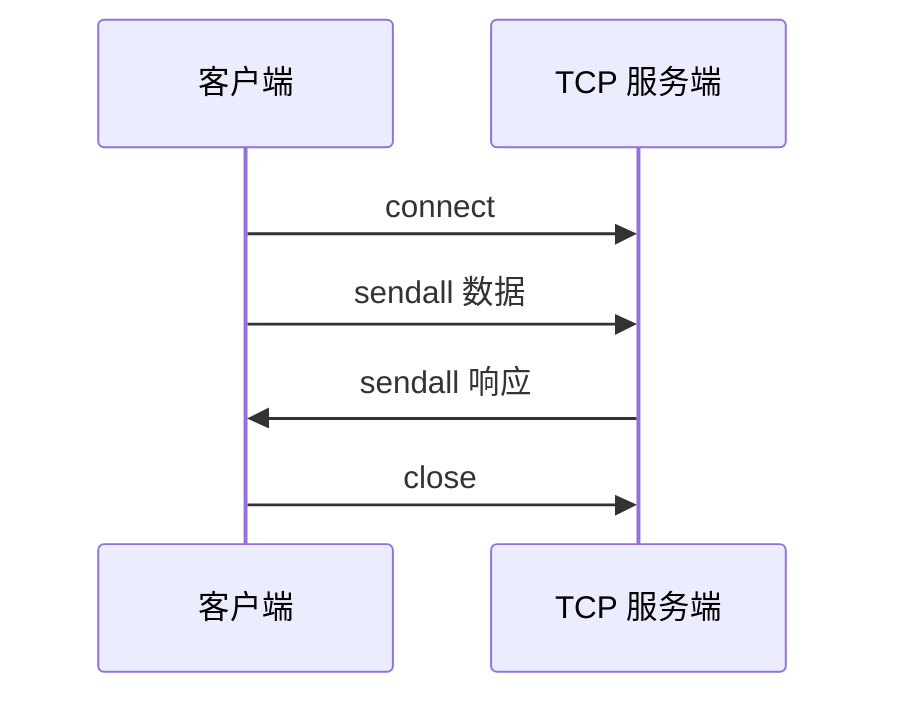

# Python 高级编程：从类到服务程序

> 推荐先掌握 Python 核心语法，再依次学习 **面向对象 → 异常与对象协议 → 数据库 → 网络 → 并发 → 项目工程化**。这几项不是彼此独立的考试点，而是构成一个后端服务的各个层次。

## 1. 类与对象：让数据和操作聚合

```python
from dataclasses import dataclass

@dataclass
class Detection:
    label: str
    score: float

    def valid(self) -> bool:
        return self.label != "" and 0.0 <= self.score <= 1.0

record = Detection("crack", 0.9)
print(record.valid())
```

**类**定义属性和操作；**实例**是具体对象；**封装**将状态与行为放在一起，并通过接口约束使用方式。

## 2. 封装、继承与多态

```python
from abc import ABC, abstractmethod

class FrameSource(ABC):
    @abstractmethod
    def read(self) -> bytes:
        pass

class FileFrameSource(FrameSource):
    def __init__(self, path):
        self.path = path

    def read(self) -> bytes:
        with open(self.path, "rb") as f:
            return f.read()

def consume(source: FrameSource):
    return len(source.read())
```

多态的重点是**不同实现遵循同一个可调用契约**。并非每个复用需求都需要继承：组件组合常比深层继承更容易维护。

## 3. Python 对象协议与反射

- `__init__`：初始化对象。
- `__repr__`：辅助调试的对象表示。
- `__len__`：实现 `len(x)`。
- `__iter__`：实现迭代协议。
- `getattr(obj, name, default)`：按名字读取属性；输入不可信时必须限制可访问成员。

```python
class Buffer:
    def __init__(self):
        self.items = []

    def __len__(self):
        return len(self.items)

    def append(self, item):
        self.items.append(item)
```

## 4. 数据库、事务与 SQL

关系型数据库通过表、主键、外键、索引和事务管理结构化数据。SQL 里的 `SELECT` 查询、`INSERT` 添加、`UPDATE` 更新、`DELETE` 删除是基础操作。



### 4.1 参数化查询防注入

```python
import sqlite3

with sqlite3.connect("demo.db") as conn:
    conn.execute("CREATE TABLE IF NOT EXISTS users (id INTEGER PRIMARY KEY, name TEXT)")
    conn.execute("INSERT INTO users(name) VALUES (?)", ("alice",))
    result = conn.execute("SELECT id, name FROM users WHERE name = ?", ("alice",))
    print(result.fetchall())
```

SQL 参数必须绑定，不能将外部输入直接拼到 SQL 字符串里。事务保证一组操作按预期共同提交或回滚，不能把每一次 `execute` 都简单理解成独立安全事务。

### 4.2 MySQL 重要概念

| 概念 | 作用 | 核心问题 |
| --- | --- | --- |
| 索引 | 加速定位行 | 是否值得额外空间与写入开销 |
| 事务 | 保证一组写入操作的一致性 | 隔离级别、锁、回滚 |
| 主键 | 唯一标识记录 | 是否稳定且唯一 |
| 外键 | 维护表间引用约束 | 删除或更新时如何处理关联 |

## 5. TCP、UDP 与 Socket

TCP 是面向连接的可靠字节流；UDP 是数据报服务，不保证到达顺序或可靠性。**TCP `recv` 一次不代表收到完整一条业务消息**，实际协议要考虑分帧。



### 5.1 本机 TCP 服务器

```python
import socket

with socket.socket(socket.AF_INET, socket.SOCK_STREAM) as server:
    server.bind(("127.0.0.1", 9000))
    server.listen(1)
    conn, addr = server.accept()
    with conn:
        data = conn.recv(1024)  # 仅供短消息实验；不是通用消息分帧方案
        conn.sendall(b"received: " + data)
```

客户端：

```python
import socket
with socket.create_connection(("127.0.0.1", 9000), timeout=3) as sock:
    sock.sendall(b"hello")
    print(sock.recv(1024))
```

## 6. 进程、线程与协程如何选？

| 机制 | 内存关系 | 适合任务 | 注意 |
| --- | --- | --- | --- |
| 多线程 | 共享同进程内存 | I/O 密集、并行等待 | 同步、竞态；CPython GIL 影响纯 Python CPU 并行 |
| 多进程 | 独立地址空间 | CPU 密集计算 | IPC、启动与序列化开销 |
| asyncio 协程 | 单线程事件循环里协作调度 | 大量异步 I/O | 阻塞调用会卡住事件循环 |

```python
from concurrent.futures import ThreadPoolExecutor
from pathlib import Path

paths = [Path("a.txt"), Path("b.txt")]

def size_if_exists(path):
    return path.stat().st_size if path.exists() else 0

with ThreadPoolExecutor(max_workers=2) as pool:
    print(list(pool.map(size_if_exists, paths)))
```

### 6.1 asyncio 示例

```python
import asyncio

async def fetch_simulated(n):
    await asyncio.sleep(0.1)  # 模拟异步等待
    return n * 2

async def main():
    print(await asyncio.gather(fetch_simulated(1), fetch_simulated(2)))

asyncio.run(main())
```

协程的优势来自让出等待时间；给同步阻塞函数加上 `async def` 不会自动让它变成非阻塞操作。

## 7. 工程分层：API 与业务逻辑分开

```text
service/
├── app.py                # HTTP 入口
├── services/             # 业务规则
├── repositories/         # 数据库读写
├── models/               # 数据结构
├── config.py             # 环境变量和配置
└── tests/                # 自动化测试
```

请求进入后顺序是：**验证输入 → 执行业务规则 → 读取或更新数据 → 生成结构化响应 → 记录错误**。不宜把 SQL、模型推理、异常处理和 HTTP 返回码全部塞进一个 Flask 路由。

## 8. 可靠性与安全边界

- 配置：密钥和数据库密码通过环境变量或安全密钥管理服务传递，不能写进仓库。
- 日志：记录错误原因、请求标识和关键耗时，不记录令牌与个人敏感数据。
- 超时：网络访问、数据库操作设定合理超时；仅对适合重试的幂等请求进行有限重试。
- 测试：覆盖正常路径、非法输入、断网、数据库失败及并发访问。

## 9. 综合作业：设备状态 API

设计一个简化设备系统：每台设备有 `device_id`、`last_seen`、`status`，支持上报心跳、查询状态、历史归档。要求把 HTTP 入口、数据模型、持久化和日志分开实现，并模拟两个设备并发上报。

**自测问题**：面向对象的多态与动态语言鸭子类型有何联系？为什么数据库要用事务？为什么 TCP 必须设计消息边界？何时使用线程池而非进程池？
