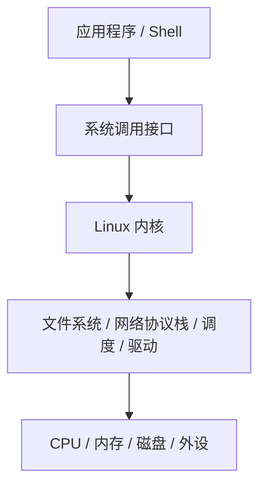
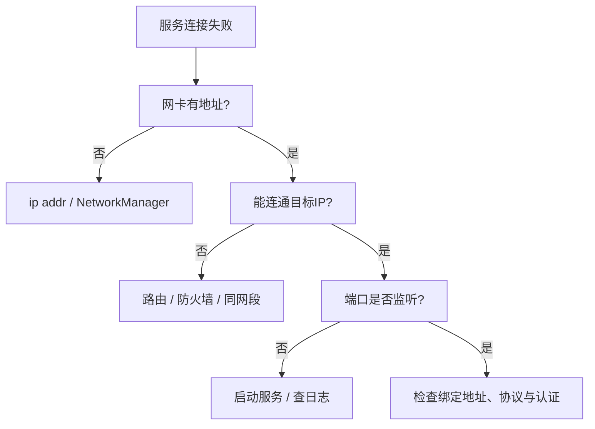

# Linux / Ubuntu：从命令行到工程排障

> **环境约定**：命令以 Ubuntu 22.04/24.04 为主；CentOS/RHEL 的 `yum`、`dnf`、`rpm` 放入单独对照节。涉及删除、格式化、网络防火墙的命令不应直接在生产设备照搬。

## 1. Linux 系统的基本层次

Linux 严格说是**内核**，Ubuntu、Debian、Fedora 等是包含内核、工具链和软件包管理器的**发行版**。Shell 解释命令；终端是人与 Shell 交互的界面；桌面环境不是 Linux 的必要组成。



```bash
uname -r              # 当前内核版本
cat /etc/os-release   # 发行版信息
whoami                # 当前用户
pwd                   # 当前工作目录
```

### 1.1 真实机、虚拟机、容器

| 环境 | 隔离层次 | 常见用途 |
| --- | --- | --- |
| 物理机 | 无虚拟机隔离 | 真实硬件驱动、机器人部署 |
| 虚拟机（VM） | 虚拟硬件与独立内核 | 多操作系统、系统实验 |
| 容器 | 共享宿主机内核、隔离进程和文件系统 | 依赖封装、服务部署 |

虚拟机网络常见 **桥接、NAT、仅主机**：桥接像局域网中的独立设备；NAT 通过宿主机或虚拟网关共享外网；仅主机主要服务宿主与虚拟机间通信。判断是否同一子网需要结合**IP 与子网掩码**，不能只看前两段是否相同。

## 2. 文件系统与路径

绝对路径以 `/` 开头；相对路径以当前目录为基准。`~` 表示当前用户主目录，`.` 是当前目录，`..` 是上级目录。

| 目录 | 作用 |
| --- | --- |
| `/etc` | 系统与服务配置 |
| `/home` | 普通用户主目录 |
| `/usr` | 大多数用户程序与共享文件 |
| `/var/log` | 日志 |
| `/dev` | 设备节点 |
| `/proc` | 内核提供的进程和系统信息接口 |
| `/tmp` | 临时文件，可能被清理 |
| `/mnt`、`/media` | 临时或可移动设备挂载点 |

```bash
ls -lah
cd ~/Documents
mkdir -p demo/data
cp source.txt demo/data/
mv demo/data/source.txt demo/data/result.txt
find . -type f -name '*.log'
```

**注意**：`rm -rf` 是不可逆地递归删除的高风险操作；优先使用 `ls`、`find` 确认目标路径，不要对不确定的变量路径直接执行。

## 3. 用户、组与权限

Linux 文件常见三组权限 `u`（所有者）、`g`（组）、`o`（其他用户），每组 `r=4`、`w=2`、`x=1`。

```text
-rwxr-x---
 │ │ │
 │ │ └── 其他用户：无权限 (0)
 │ └──── 所属组：r-x (5)
 └────── 所有者：rwx (7)
```

```bash
id
ls -l myscript.sh
chmod 750 myscript.sh
sudo chown "$USER":"$(id -gn)" myscript.sh
```

**文件目录的 x 权限含义不同**：普通文件可执行；目录允许进入/遍历。目录能否列出条目与 `r` 有关，能否访问其中某个已知路径还需要 `x`。`sudo` 只对当前命令提权，不应依赖永久 root 账户工作。

## 4. Shell、管道、重定向与退出码

```bash
printf '%s\n' 'hello' > output.txt  # 覆盖写入
printf '%s\n' 'world' >> output.txt # 追加
cat output.txt | grep -n 'world'
find . -type f -name '*.py' -print
```

- `|` 把左侧标准输出传给右侧标准输入；`>`、`>>` 重定向标准输出；`2>` 单独重定向错误输出。
- `$?` 是上一条命令的退出状态，通常 `0` 表示成功，但**不同程序可约定不同状态码**。
- `grep` 适合逐行文本过滤，`find` 适合搜索文件，`awk` 适合按列处理，`sed` 适合流式文本替换。

```bash
set -euo pipefail      # 用于有明确失败处理策略的 Bash 脚本
log_dir="${HOME}/logs"
mkdir -p "$log_dir"
```

`set -e` 并非对一切失败都按直觉退出，尤其在条件、管道与子 Shell 中，仍应显式检查重要命令的返回值。

## 5. 编辑器、环境变量与包管理

### 5.1 Vim 常用动作

| 按键 | 作用 |
| --- | --- |
| `i` | 进入插入模式 |
| `Esc` | 回到普通模式 |
| `:wq` | 保存并退出 |
| `:q!` | 放弃本次修改 |
| `/text` | 搜索字符串 |

### 5.2 PATH 与 Python 虚拟环境

```bash
printf '%s\n' "$PATH"
which python3
python3 -m venv .venv
source .venv/bin/activate
python -m pip install -U pip
python -m pip list
```

`PATH` 决定 Shell 去哪里找可执行文件；`venv` 主要隔离 Python 包，不等于虚拟机。Ubuntu 常用 `apt`：

```bash
sudo apt update
sudo apt install -y git curl htop
apt policy git
sudo apt remove package-name
```

不要在 Ubuntu 环境中把 `yum`、`rpm` 当作首选包管理命令。

## 6. 进程、线程与服务

| 概念 | 作用 | 常用工具 |
| --- | --- | --- |
| 进程 | 程序运行实例、拥有独立地址空间 | `ps`, `top`, `pgrep` |
| 线程 | 同进程内的执行流、共享内存 | `top -H`, `ps -L` |
| 守护服务 | 持续运行的后台服务 | `systemctl`, `journalctl` |

```bash
ps aux | grep python
pgrep -af 'python.*app.py'
kill -TERM 12345      # 请替换为确认过的 PID；先优雅退出
ss -ltnp             # 查看 TCP 监听端口
```

**为什么关闭终端后 Flask 进程会停？** 前台进程通常受终端会话及信号影响。用于长期运行的服务应交给 `systemd` 管理，而不是长期依赖开着的 SSH 会话。

### 6.1 systemd 服务完整例子

创建 `/etc/systemd/system/road-app.service`（按实际部署修改账户和路径）：

```ini
[Unit]
Description=Python Web Application
After=network-online.target
Wants=network-online.target

[Service]
Type=simple
User=ubuntu
WorkingDirectory=/opt/road-app
ExecStart=/opt/road-app/.venv/bin/python app.py
Restart=on-failure
RestartSec=3

[Install]
WantedBy=multi-user.target
```

```bash
sudo systemctl daemon-reload
sudo systemctl enable --now road-app
systemctl status road-app
journalctl -u road-app -n 100 --no-pager
```

务必确认 `User`、`WorkingDirectory` 与 `ExecStart` 真实存在；不要将开发服务器直接暴露到公网作为生产服务。

## 7. 磁盘、挂载和空间排查

```bash
lsblk -f                  # 分区、文件系统、挂载点
df -h                    # 文件系统的可用空间
du -sh ~/* ~/.cache 2>/dev/null | sort -h
findmnt -T /mnt/usb       # 确认路径属于哪个挂载设备
mount | grep /dev/sd
```

- `df` 查**文件系统整体**剩余空间，`du` 查**目录内容大小**，数据可能因删除但仍被进程占用的文件等原因不一致。
- `chmod 777` 不一定解决 U 盘复制失败：NTFS/exFAT/FUSE 可能使用挂载选项映射权限，也要检查磁盘是否只读、剩余空间、文件名及 I/O 错误。
- 删除大缓存前先确认应用不运行且文件可重新生成；不要直接清空系统数据库或包管理目录。

## 8. 网络配置与诊断顺序



```bash
ip addr
ip route
ping -c 3 192.168.1.1
getent hosts example.com
ss -lunp
curl -v http://127.0.0.1:5000/  # 测试本机服务
```

**localhost 与 0.0.0.0 不同**：`127.0.0.1` 仅回环地址；服务器绑定 `0.0.0.0` 是监听本机所有 IPv4 接口，但客户端必须使用可访问的真实 IP，不能连接到“0.0.0.0”。

## 9. 定时任务与日志

`cron` 适合常规周期任务；`at` 适合单次任务；`systemd timer` 适合可记录状态、可与服务关联的任务。

```bash
crontab -l
crontab -e
journalctl -b -p warning --no-pager
sudo journalctl -u ssh -n 50
```

crontab 任务的 PATH 通常与交互式 Shell 不同，应使用程序绝对路径、处理工作目录并记录日志。

## 10. Ubuntu 与 CentOS/RHEL 差异

| 任务 | Ubuntu/Debian | Fedora/RHEL |
| --- | --- | --- |
| 安装包 | `apt install` | `dnf install`（旧系统可能 `yum`） |
| 低层包格式 | `.deb`、`dpkg` | `.rpm`、`rpm` |
| 防火墙常见前端 | `ufw`（不一定启用） | `firewalld`（视发行版） |
| 查看 systemd 服务 | `systemctl` | `systemctl` |

## 11. 综合练习：服务连不上怎么办？

1. `systemctl status` 判断服务是否运行；再看 `journalctl` 获取错误日志。
2. `ss -ltnp` 看是否监听预期端口和绑定地址。
3. 先在服务器本机 `curl 127.0.0.1:端口`，再由局域网其他主机访问。
4. 再检查防火墙、云安全组、路由和 DNS；不要靠重复重启猜原因。
5. 最后记录故障原因、复现条件与修复验证命令。

**学习验证**：能够解释“终端、Shell、进程、服务、IP、端口、挂载”之间的区别，并在全新 Ubuntu 主机上独立部署一个持续运行的 Python 服务。
