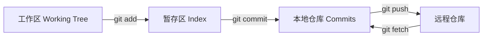
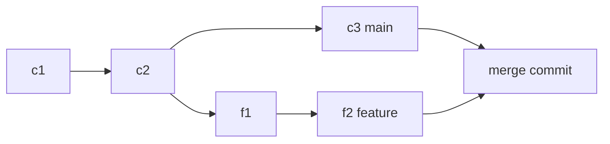

# Git：先理解模型，再记命令

> 组织路线：为什么版本控制 → 三个工作区域 → 提交图 → 分支 → 远程协作 → 回退恢复 → 清理历史。命令在 PowerShell、Bash 中基本通用，路径写法按系统调整。

## 1. Git 保存的到底是什么？

Git 是分布式版本控制系统。提交（commit）记录一个项目快照及元数据，并指向父提交；分支本质上是指向提交的**可移动引用**，不是一个独立复制的目录。



```bash
git config --global user.name "Your Name"
git config --global user.email "your-email@example.com"
git config --global --list
git --version
```

姓名邮箱是提交署名信息，并不等于 GitHub 登录凭据。不要在文档里放真实 Token，也不建议为了省事将明文凭据长期存储在磁盘上。

## 2. 初始化与第一次提交

```bash
mkdir demo-git
cd demo-git
git init
printf 'hello\n' > README.md
git status
git add README.md
git commit -m "Initial documentation"
git log --oneline --decorate --graph
```

`git init` 新建本地仓库；`git clone URL` 下载已有仓库及历史。`.git` 目录包含 Git 的对象、引用和设置；不要误认为它仅用于保存当前文件。

## 3. 文件状态、暂存与差异

| 状态 | 含义 | 查看/操作 |
| --- | --- | --- |
| Untracked | Git 尚未跟踪 | `git status`、`git add` |
| Modified | 已跟踪文件在工作区被修改 | `git diff` |
| Staged | 改动进入暂存区 | `git diff --cached` |
| Committed | 改动被写入提交快照 | `git show HEAD` |

```bash
git status --short
git diff                 # 工作区与暂存区的区别
git diff --cached        # 暂存区与 HEAD 的区别
git add -p               # 按修改块暂存
git restore -- README.md # 丢弃未暂存修改，注意会丢数据
```

## 4. .gitignore 为什么有时不生效？

`.gitignore` 只影响未被跟踪的文件；已经提交过的文件仍受版本控制。

```gitignore
.venv/
__pycache__/
*.pyc
.env
node_modules/
site/
```

```bash
git check-ignore -v .venv/test.py
git rm --cached .env       # 仅停止跟踪；本地文件保留
git commit -m "Stop tracking local secrets"
```

**重要**：如果密钥过去已经提交到远程仓库，即使现在移出跟踪，也不能认为密钥安全；应先撤销/更换密钥，再评估清理历史的需要。

## 5. 分支、合并、冲突



```bash
git switch -c feature/docs
# 修改文件并 git add / git commit
git switch main
git merge feature/docs
git branch -d feature/docs
```

发生冲突时 Git 会在文件中标记冲突区，手工理解两边变更后修改，删除冲突标记，再 `git add` 和 `git commit` 或执行对应流程的 `git rebase --continue`。

## 6. merge 和 rebase 的区别

`merge` 保留两条分支历史，并可能生成合并提交；`rebase` 将一系列提交重新应用到新的基底上，**提交 ID 会改变**。

```bash
git switch feature/docs
git fetch origin
git rebase origin/main
# 遇到冲突：修改文件，git add <文件>，git rebase --continue
# 想放弃整个 rebase：git rebase --abort
```

对多人共享、已发布的提交不要随意 rebase 再强推，否则会使其他人的本地历史与远程分叉。

## 7. reset、restore、revert 不要混用

| 命令 | 改变什么 | 适用场景 |
| --- | --- | --- |
| `restore` | 恢复工作区或暂存区文件 | 放弃未提交修改 |
| `reset --soft` | 移动 HEAD，保留暂存 | 重新组织最近一次本地提交 |
| `reset --mixed` | 移动 HEAD、重置暂存（默认） | 撤销本地提交但保留工作区修改 |
| `reset --hard` | 移动 HEAD、暂存与工作区都重置 | **会丢未保存内容**，仅明确确认后使用 |
| `revert` | 创建新提交反向抵消旧提交 | 已推送的公共历史上更安全 |

```bash
git log --oneline -5
git reflog -10
git revert <commit-id>  # 保留公开历史，以新提交反向撤销
git stash push -m "wip before refactor"
git stash list
```

`reflog` 可找回很多意外移动的引用，但不是永久备份；过期或垃圾回收后可能无法恢复。

## 8. fetch、pull、push 的数据流

```bash
git remote -v
git fetch origin           # 下载对象和远程引用，不自动合并工作区
git log --oneline HEAD..origin/main
git pull --ff-only         # 仅允许快进，避免意外合并提交
git push -u origin main
```

`git pull` 通常等于 `fetch + merge`（或配置的 rebase）；不建议在尚未理解分叉时直接不断 `pull`、`push --force`。

## 9. 为什么仓库文件只有几十 MB，clone 却更大？

**Git 仓库大小 ≠ 当前工作区大小**。旧版本的大文件、构建产物、图片和历史提交可能仍保存在 `.git/objects` 中。

```bash
git count-objects -vH
git rev-list --objects --all     # 列出历史对象；结果可能很多
```

### 9.1 只想删除历史、保留当前文件：安全方案

对于**个人仓库**且确定无需保留历史时，优先在新目录创建只有当前文件的新仓库，再推送到新仓库。若必须覆盖原仓库历史，先本地备份，并确认没有其他协作者依赖原历史。下面是**思路示意**，不是可无脑执行的修复脚本：

```text
现有仓库（完整历史） → 备份 → 只复制工作文件（不复制 .git）
→ git init → 首次提交 → 确认远程目标 → 必要时受控替换远程分支
```

改写远程历史会改变提交 ID，也可能影响 GitHub Pages、PR、链接和他人本地仓库；`git gc` 仅做对象清理，不等同于删除已发布的提交历史。

## 10. GitHub Pages / MkDocs 实战

```bash
python -m pip install -r requirements.txt
python -m mkdocs build --clean
python -m mkdocs serve
git status
git add docs/ mkdocs.yml
git commit -m "Update documentation"
git push origin main
```

**常见异常**：Windows 提示找不到 `mkdocs` 时优先检查当前 Python 环境与依赖，尝试 `python -m mkdocs`；行尾 `LF/CRLF` 警告通常属于换行规范提示，不是推送失败。

## 11. 一次标准协作流程

1. 在主分支 `fetch/pull --ff-only` 确认基线。
2. 新建功能分支、分步修改并提交有明确目的的小提交。
3. 推送分支并提交 PR，审查差异和 CI。
4. 合并后同步主分支，删除不再需要的临时分支。
5. **任何强制推送或历史清理前必须备份并通知协作者**。

**自测**：能够解释工作区、暂存区、提交、HEAD、分支和远程分支之间的关系；能独立恢复一次本地误操作。
