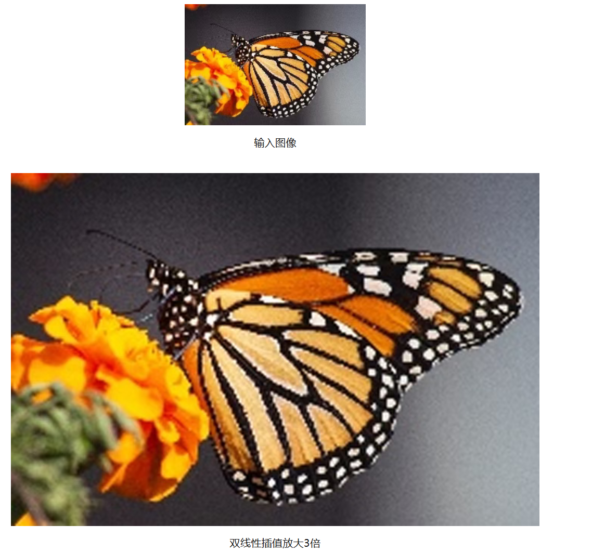
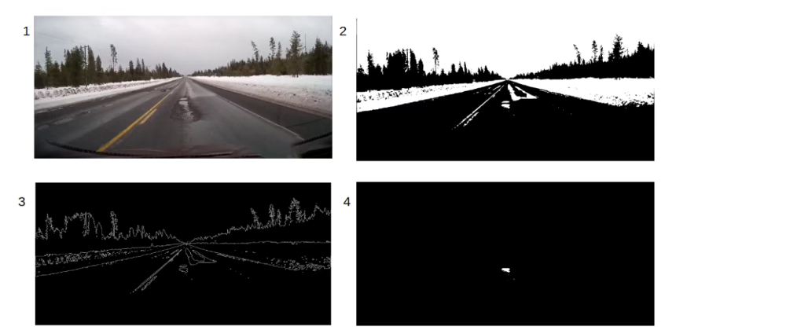
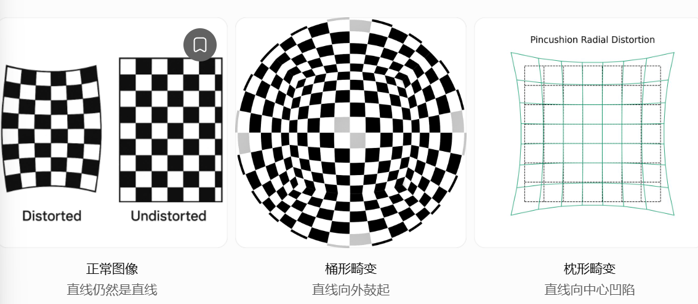

# OpenCV 实战项目

基础 API 和理论知识见 [OpenCV 知识点](./opencv知识点.md)。

# 一.图像处理

1.利用Opencv实现基于深度学习的**超分辨率处理**

- 图像超分辨率：利用算法，从一张 / 多张模糊低分辨率 (LR) 图像，重建出细节更丰富的高分辨率 (HR) 图像。
- 

2.CNN输入**固定尺寸图像改为任意尺寸图像**

- **ResNet-18**：残差卷积神经网络
- **CNN**：**输入层**（读取图片的像素数据）->**卷积层**（提取边缘、纹理、形状等特征）->**激活层**（引入非线性，增强表达能力）->**池化层**（缩小特征图，保留重要信息）->**分类层/全连接层**（综合提取出的特征进行判断）->**输出**（例如预测为猫的概率为98%）
  - 核心技术：卷积
  - 本质就是使用一个小矩阵（卷积核），在图像上不断滑动，每滑动一次就进行一次乘法和加法，最终提取出图像中的特征
- 正常情况下需要对输入图像进行裁剪或调整大小使其满足CNN网络所需的输入大小，但是会造成分辨率下降，非正方形长宽比，计算量大的局限
- FC和卷积层在目标输入上有所不同–卷积层侧重于局部输入区域，而FC层则将全局特征组合在一起。但是，FC层和卷积层都计算点积，因此在本质上是相似的。所以满足两者之间互相转换的条件。
- 由于存在FC层，因此网络智能接收固定大小的输入，改成任意尺寸图像就是将FC层替换成全是卷积层的

3.OpenCV实现**图像覆盖**

- jpg图像和png图像
  - jpg图像只有3个通道，png图像有4个通道（多了一个不透明度）
  - jpg图像通常使用有损压缩，png图像使用无损压缩

---

- **数据可视化**
  - 标记数据集中图像的类别
- **数据增强**
  - 需要增强我们的数据集，为训练提供更多数量的图像。在数据增强时，我们旋转并翻转数据集中的每幅图像。
- **数据分割**
  - 将我们的数据分割成训练集和测试集，训练集中包含将要被CNN模型训练的图像，测试集中包含将要被我们模型测试的图像。

---

# 二.图像路面应用

1.OpenCV检测坑洼

- 直方图：统计一张图片中，每一种像素值出现了多少次，然后把统计结果画成柱状图（横坐标X是像素值是多少（灰度值0~255），纵坐标是这种像素值出现了多少次）
- 卷积核＋阈值＋边缘检测
- 

2.OpenCV车道线检测

- 摄像机校准

  - 径向失真：镜头使图像中的点沿着远离或靠近畸变中心的方向发生偏移，导致直线弯曲
  - 

- 车道像素查找

  - 像素值是二进制的

    - 计算机在存储图像像素时，使用的是由0和1组成的二进制数据

    - 

    - | 十进制 | 二进制   |
      | ------ | -------- |
      | 0      | 00000000 |
      | 1      | 00000001 |
      | 2      | 00000010 |
      | 10     | 00001010 |
      | 100    | 01100100 |
      | 255    | 11111111 |

  - 滑动窗口

    - 使用一个固定大小的窗口在图像上按照一定的长不断移动，每移动一次，就对窗口覆盖的区域进行分析

