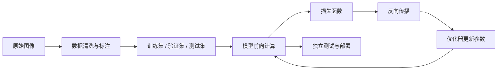
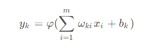
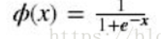
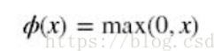
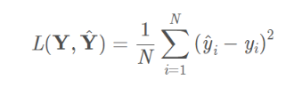
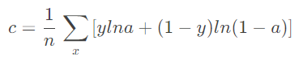
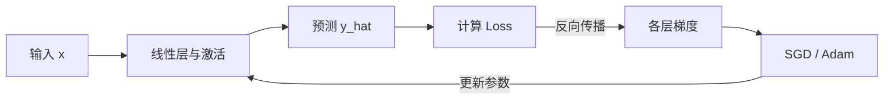
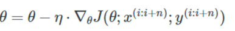
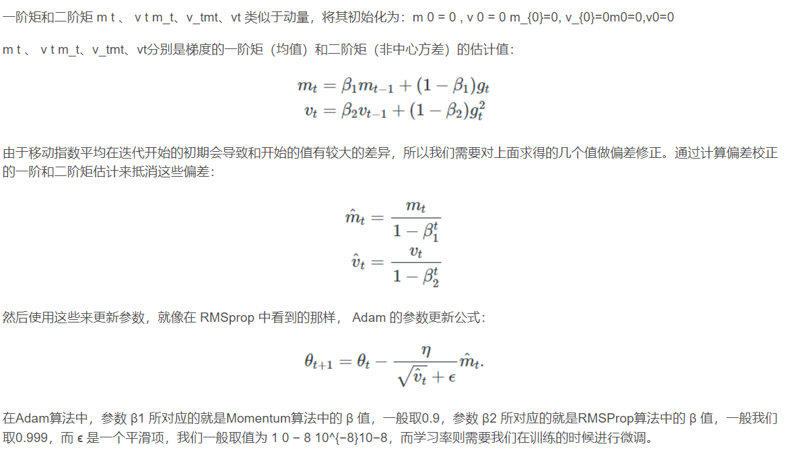
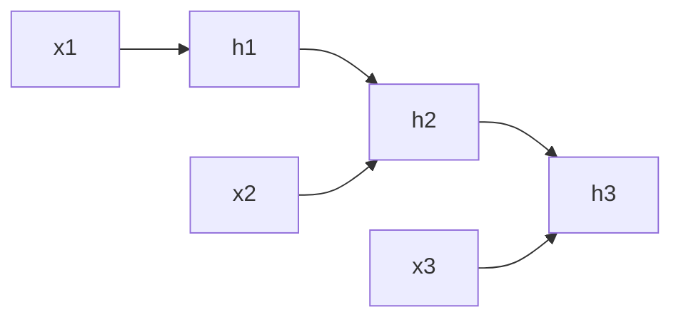

# 深度学习：从数学原理到模型训练

> **阅读路线**：问题类型 → 张量和神经元 → 前向传播 → 损失函数 → 反向传播 → 优化器 → 网络结构 → 训练调优 → 视觉应用。
> 本文整合原笔记中分散的激活函数、损失函数、梯度下降、CNN、超参数、RNN 与 LSTM；示例以 Python/PyTorch 为主。

## 1. 先建立整体认知

### 1.1 机器学习与深度学习的关系

机器学习通过数据学习规律，深度学习主要用**多层可训练的神经网络**学习输入到输出的映射。两者不是并列技术：深度学习属于机器学习。

| 学习范式 | 数据与目标 | 典型任务 |
| --- | --- | --- |
| 监督学习 | 有输入和标签 | 图像分类、缺陷检测、回归 |
| 无监督学习 | 无人工任务标签 | 聚类、表示学习 |
| 自监督学习 | 从数据自身构造训练目标 | 对比学习、掩码预测 |
| 强化学习 | 与环境交互并利用奖励 | 策略控制、决策 |

注意：**监督方式**与**网络结构**是两个不同维度。CNN 不等同于监督学习，Transformer 也可以用于监督和自监督任务。

### 1.2 视觉任务有何区别？

| 任务 | 输出 | 评价重点 |
| --- | --- | --- |
| 分类 | 整张图像的类别 | Accuracy、F1 |
| 目标检测 | 类别及边界框 | mAP、Precision、Recall |
| 图像分割 | 像素级类别或实例掩码 | IoU、Dice |
| 回归 | 连续数值，如距离/关键点 | MAE、RMSE |
| 旋转框检测（OBB） | 位置、尺寸与方向 | 旋转 IoU、OBB mAP |



## 2. 神经元、张量与前向传播

### 2.1 单个神经元

设输入为 $x=(x_1,\dots,x_n)$，权重为 $w$，偏置为 $b$：

$$
z=\sum_{i=1}^{n}w_ix_i+b,\qquad a=\phi(z)
$$

其中 $z$ 是**线性变换结果**，$\phi$ 是**激活函数**，$a$ 才是神经元输出。没有非线性激活，多层线性层仍然等价于一个线性变换。



### 2.2 为什么神经网络用张量？

张量可理解为具有任意维数的数据容器。以图像为例，常见 PyTorch 输入形状为 `[N,C,H,W]`：批大小、通道数、高和宽。

```python
import torch
x = torch.randn(8, 3, 224, 224)  # 8 张 RGB 图像
print(x.shape, x.dtype)
```

设计卷积网络时必须区分 **空间尺寸** 与 **通道数**。前者影响特征图分辨率，后者表示可学习的特征维度。

## 3. 激活函数：负责引入非线性

| 函数 | 定义/特点 | 常见用途 | 局限 |
| --- | --- | --- | --- |
| Sigmoid | $1/(1+e^{-x})$，输出 (0,1) | 二分类概率输出 | 饱和区域梯度小 |
| Tanh | 输出 (-1,1) | 经典循环网络 | 仍会梯度饱和 |
| ReLU | $\max(0,x)$ | CNN 隐藏层 | 负半轴可能失活 |
| Leaky ReLU | 负半轴保留小斜率 | 缓解死 ReLU | 斜率是超参数 |
| Softmax | 多类得分归一化 | 互斥多分类概率 | 不适合独立多标签任务 |




Softmax 对一个分类向量 $z$ 定义：

$$
p_i=\frac{e^{z_i}}{\sum_j e^{z_j}}
$$

训练多分类模型时，PyTorch `CrossEntropyLoss` **直接接收 logits**，不应在其前面重复执行 Softmax。

## 4. 损失函数：负责度量预测误差

损失函数是训练优化的目标，和激活函数的功能不同。

| 任务 | 常用损失 | 关键含义 |
| --- | --- | --- |
| 连续数值回归 | MSE / MAE / Huber | 预测值偏离真实值的程度 |
| 互斥多分类 | Cross Entropy | 正确类别概率越小惩罚越大 |
| 二分类、多标签 | BCEWithLogitsLoss | 每个类别独立二元判断 |
| 目标检测 | 分类损失 + 框回归损失 | 同时判断“是什么”“在哪里” |

回归示例：

$$
\operatorname{MSE}=\frac1N\sum_{i=1}^{N}(y_i-\hat y_i)^2,\qquad
\operatorname{MAE}=\frac1N\sum_{i=1}^{N}|y_i-\hat y_i|
$$

MSE 更重罚大误差；MAE 相对不敏感于离群点。不能仅依“损失越小”判断模型好坏，必须观察独立验证集。




## 5. 反向传播与梯度下降：模型怎样学习？

训练一次参数更新分为三步：**前向传播算预测 → 计算损失 → 链式法则求梯度并更新权重**。

$$
\theta_{t+1}=\theta_t-\eta\nabla_\theta L(\theta_t)
$$

- $\theta$：权重和偏置的集合；$\eta$：学习率；$\nabla_\theta L$：损失对参数的梯度。
- 反向传播求梯度，优化器决定如何用梯度更新参数。两者不是同一个概念。
- 梯度由计算图与链式法则得到；神经网络并不是“试到正确答案才记住”。



### 5.1 SGD、批量与 Adam

| 方法 | 特点 | 选择建议 |
| --- | --- | --- |
| BGD | 每轮用全部训练样本计算梯度 | 小数据集，计算量可能大 |
| SGD | 理论上一次单样本更新；实践常指 mini-batch SGD | 可控，泛化常较好 |
| Mini-batch | 每次一小批样本 | 深度学习的常规方式 |
| Momentum | 累计梯度方向，减小振荡 | 常与 SGD 配合 |
| Adam / AdamW | 自适应调整各参数步长 | 常用起点，AdamW 将权重衰减解耦 |




## 6. 完整可运行的神经网络训练例子

以下是**合成二维二分类数据**，可以单独运行，不依赖外部数据集。

```python
import torch
from torch import nn

torch.manual_seed(42)
x = torch.randn(1200, 2)
y = ((x[:, 0] ** 2 + x[:, 1]) > 0.5).float().unsqueeze(1)
train_x, val_x = x[:1000], x[1000:]
train_y, val_y = y[:1000], y[1000:]

model = nn.Sequential(nn.Linear(2, 16), nn.ReLU(), nn.Linear(16, 1))
loss_fn = nn.BCEWithLogitsLoss()
optimizer = torch.optim.AdamW(model.parameters(), lr=0.01)

for epoch in range(100):
    model.train()
    logits = model(train_x)
    loss = loss_fn(logits, train_y)
    optimizer.zero_grad()  # 防止累计上一次梯度
    loss.backward()        # 自动求导
    optimizer.step()       # 更新参数

model.eval()
with torch.no_grad():
    val_logits = model(val_x)
    pred = (torch.sigmoid(val_logits) >= 0.5).float()
    accuracy = (pred == val_y).float().mean().item()
print(f"validation accuracy = {accuracy:.3f}")
```

关键区别：`model.train()` 控制训练行为；`model.eval()` 控制推理行为；`torch.no_grad()` 关闭梯度记录。验证集用于调参，最终汇报性能应使用未参与调参的测试集。

## 7. 多层感知机与 CNN

### 7.1 MLP 的局限

多层感知机（MLP）将输入转换成特征向量，适合结构化数据；直接处理大尺寸图像时，会丢失二维局部空间先验并引入大量参数。

### 7.2 卷积为什么适合图像？

卷积核在空间位置上**共享权重**，反复提取边缘、纹理等局部特征。卷积核输出通道数量决定新特征图通道数。


卷积输出高度（宽度同理）：

$$
H_{out}=\left\lfloor\frac{H+2P-D(K-1)-1}{S}+1\right\rfloor
$$

这里 $K$ 为核大小、$P$ 为填充、$S$ 为步长、$D$ 为膨胀率。参数量通常为 $C_{out}(C_{in}K_hK_w+1)$（带偏置）。

```python
import torch
from torch import nn
net = nn.Sequential(
    nn.Conv2d(3, 16, kernel_size=3, padding=1),
    nn.ReLU(),
    nn.MaxPool2d(2),
    nn.Conv2d(16, 32, kernel_size=3, padding=1),
    nn.ReLU(),
    nn.AdaptiveAvgPool2d((1, 1)),
    nn.Flatten(),
    nn.Linear(32, 4),
)
print(net(torch.randn(2, 3, 128, 128)).shape)  # [2, 4]
```

## 8. 过拟合、欠拟合和超参数

**欠拟合**：训练误差与验证误差都大；**过拟合**：训练误差低，验证误差明显更高。

| 现象 | 优先排查 | 典型改进 |
| --- | --- | --- |
| 训练集拟合不上 | 学习率、模型容量、标签质量 | 调整容量/优化器/训练轮次 |
| 训练好但验证差 | 数据泄漏、分布偏差、过拟合 | 更多数据、数据增强、正则化 |
| 损失为 NaN | 梯度爆炸、非法输入、学习率 | 梯度裁剪、检查数据、降低学习率 |
| 精度高但漏检严重 | 类别不平衡、阈值设置 | 查看 Recall、按类别分析 |

重要超参数：学习率、批大小、训练轮数、权重衰减、网络宽深、输入分辨率、增强策略。**参数**是训练中学出来的权重；**超参数**是训练前或训练过程中人为配置的设置。

## 9. RNN 与 LSTM：序列信息如何传播

RNN 用前一时刻隐藏状态与当前输入计算新的隐藏状态：

$$
h_t=\phi(W_xx_t+W_hh_{t-1}+b)
$$



长序列训练可能出现梯度消失或爆炸。LSTM 在隐藏状态之外维护细胞状态，用**遗忘门、输入门、输出门**控制信息保留和输出。RNN/LSTM 在时间序列和传感器序列中仍有用途，但在许多语言和视觉任务中已常用注意力架构。

```python
import torch
from torch import nn
lstm = nn.LSTM(input_size=6, hidden_size=12, batch_first=True)
x = torch.randn(4, 20, 6)       # 4条序列，每条20步，每步6维
out, (h_n, c_n) = lstm(x)
print(out.shape, h_n.shape)       # [4,20,12], [1,4,12]
```

## 10. 模型评估、计算量与视觉项目

- 分类：混淆矩阵、Precision、Recall、F1，类别不平衡时不能只看 Accuracy。
- 检测：IoU、PR 曲线、mAP，区分框定位误差与类别识别错误。
- 部署：参数量反映模型存储规模；FLOPs 近似计算量，但**不直接等于**延迟或吞吐。推理 FPS 受 GPU、内存、预处理和后处理共同影响。
- 数据划分：同一视频相邻帧高度相关，应按采集场景或视频分组，避免训练/验证泄漏。

### 10.1 一个实用的 YOLO 数据流


```python
from ultralytics import YOLO

# 使用已准备好的数据配置；路径按自己的项目修改
model = YOLO('yolov8n.pt')
model.train(data='data.yaml', imgsz=640, epochs=30)
metrics = model.val()
print(metrics)
```

若项目标注的是旋转框，必须使用 OBB 任务对应的模型与标签格式，不能简单将水平框训练命令当作 OBB 训练流程。

## 11. 复习题与实践清单

1. 为什么线性层之间不加激活函数，网络仍是线性映射？
2. 区分 `loss.backward()`、`optimizer.step()`、`zero_grad()`。
3. 推导一个 `3×3` 卷积的输出尺寸与参数量。
4. 同一个数据集为何可能出现“训练分数极好、实车漏检严重”？
5. 实践：记录训练与验证损失，绘制混淆矩阵，按场景统计错误类型。

**术语索引**：logits / gradient / epoch / batch / learning rate / regularization / IoU / mAP / FLOPs / inference latency。
